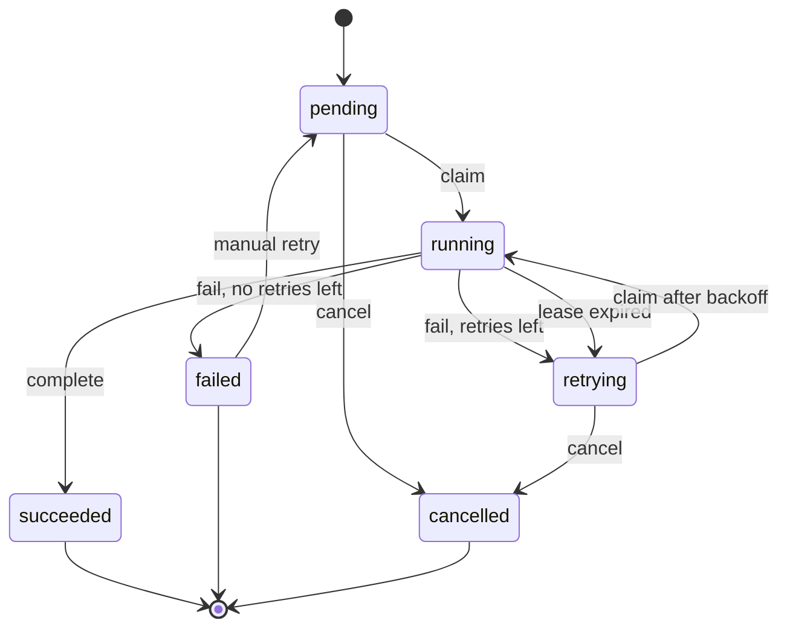

# Asynchronous job design

- **Status:** Draft for review (2026-11-23)
- **Elaborates:** [ADR-0008](../adr/ADR-0008-internal-api-and-worker.md), [ADR-0009](../adr/ADR-0009-async-job-model.md)
- **Source:** section 8 of the [technical design](../game-platform-technical-design.md); tables `system.background_jobs`, `system.outbox_events`, `operation.reward_jobs` in [schema.sql](../database/schema.sql)

Where this document and an ADR disagree, the ADR wins. Items marked **(proposal)** are not stated in the design document or an ADR and need confirmation.

## 1. What runs asynchronously

Batch mail delivery, batch reward grants, statistics, leaderboard rebuilds, expired-data cleanup, save snapshots, config cache refresh, and retries of failed tasks. None of these runs inside an HTTP request.

V1 uses PostgreSQL as the queue. There is no message broker.

## 2. Parts

| Part | Table or process | Purpose |
|---|---|---|
| Job queue | `system.background_jobs` | Work to execute, with state, retries and lease |
| Outbox | `system.outbox_events` | Events that must be published if and only if a business transaction committed |
| Business record of a batch | `operation.reward_jobs` | What the operator asked for, with progress counters; points at its background job |
| Executor | `game-worker` | Claims jobs, calls `gamecore` in-process |

A job or outbox row is inserted in the same transaction as the business change that causes it. If the transaction rolls back, the job does not exist.

## 3. Job states



## 4. Claiming

```sql
UPDATE system.background_jobs
SET status = 'running',
    lease_owner = $1,
    lease_expires_at = now() + make_interval(secs => $2),
    heartbeat_at = now(),
    started_at = COALESCE(started_at, now())
WHERE id = (
    SELECT id FROM system.background_jobs
    WHERE status IN ('pending', 'retrying') AND run_at <= now()
    ORDER BY priority DESC, run_at
    FOR UPDATE SKIP LOCKED
    LIMIT 1
)
RETURNING *;
```

`SKIP LOCKED` lets several worker instances claim without blocking each other. The partial index `background_jobs_claim_idx` serves the inner query.

## 5. Lease, heartbeat, reclaim

- A claim sets a lease **(proposal: 60 seconds)**.
- The worker refreshes `heartbeat_at` and `lease_expires_at` while it works **(proposal: every 20 seconds)**.
- A reaper pass in every worker moves `running` jobs whose lease expired back to `retrying` and increments `retry_count`. A crashed worker therefore loses its jobs after one lease period.
- A worker that discovers it lost its lease stops and does not mark the job complete.

## 6. Retry and backoff

- `max_retries` is per job (default 5 in the schema).
- **(proposal)** Backoff: `run_at = now() + min(base × 2^retry_count, cap)` with `base = 10 s`, `cap = 15 min`, plus up to 20% jitter.
- A failure stores `last_error`. When `retry_count` reaches `max_retries` the job becomes `failed`.
- Errors that cannot succeed on retry (validation failures, missing targets) fail immediately.
- An operator can retry a failed job or cancel a pending one from the GM console. Both are audited. The design lists manual retry as a capability; the GM API has no endpoint for it yet.

## 7. Idempotent execution

Delivery is at-least-once. Every handler must give the same result when run twice.

| Job | How a repeat becomes a no-op |
|---|---|
| Mail delivery | `UNIQUE (game_id, mail_id, player_id)` on `operation.player_mail`; insert with `ON CONFLICT DO NOTHING` |
| Batch reward | Ledger unique key with `source_type = 'reward_job'`, `source_id` = reward job ID |
| Statistics | Upsert on `(game_id, stat_date)` or `(game_id, stat_date, player_id)` |
| Leaderboard snapshot | `UNIQUE (game_id, board_id, period_key)` |
| Save snapshot | `UNIQUE (game_id, player_id, save_version)` |
| Cleanup | Deleting already-deleted rows changes nothing |
| Enqueue | `background_jobs_dedupe_uniq` on `(job_type, dedupe_key)` stops the same job being queued twice |

## 8. Large batches

A batch over many players is one job that works in pages, not one job per player.

1. The job payload holds the target definition and a cursor (last processed player ID).
2. Each iteration loads a page **(proposal: 500 players)**, processes it in one transaction, updates the cursor in the job payload and the counters on `operation.reward_jobs`, then heartbeats.
3. After a crash the next claimant resumes from the stored cursor. Players of the interrupted page are re-attempted and deduplicated by the keys above.

`reward_jobs.target_count`, `processed_count` and `failed_count` give the operator a progress view.

## 9. Job catalogue

| `job_type` | Created by | Notes |
|---|---|---|
| `mail_delivery` | `gm-api`, on mail send | Linked from `reward_jobs` |
| `batch_reward` | `gm-api` | Linked from `reward_jobs` |
| `compensation` | `gm-api` | Linked from `reward_jobs` |
| `stats_aggregation` | Scheduler | Fills `analytics.daily_game_stats` and `daily_player_stats` |
| `leaderboard_rebuild` | Scheduler or operator | Rebuilds the Redis read model from `leaderboard_entries`; writes period snapshots |
| `save_snapshot` | Scheduler | Writes `player_save_snapshots` |
| `expired_data_cleanup` | Scheduler | Expired sessions, idempotency keys, ad sessions, finished jobs past retention |
| `config_cache_refresh` | Outbox, on config release | Refreshes caches and CDN |

The first three match the `job_type` check on `operation.reward_jobs`; the last five match the task types of `POST /internal/v1/maintenance/tasks`.

**(proposal)** Scheduling is done inside `game-worker`: a small scheduler enqueues recurring jobs with a `dedupe_key` such as `stats_aggregation:2026-11-23`, so several worker instances cannot enqueue the same run twice.

## 10. Outbox

- A business transaction inserts an `outbox_events` row (`aggregate_type`, `aggregate_id`, `event_type`, `payload`).
- The worker polls unpublished rows ordered by `next_attempt_at`, handles each one (in V1: enqueue a job or refresh a cache), then sets `published_at`.
- A failed attempt increments `attempts`, stores `last_error` and pushes `next_attempt_at` forward with the same backoff as jobs.
- Consumers must tolerate a repeated event.

In V1 the outbox has no external subscriber. It exists so that "the release committed" and "the cache refresh was requested" cannot diverge, and so a broker can be attached later without changing business code.

## 11. Worker and internal API

`game-worker` calls `gamecore` directly. It does not use `internal-api`, which is not deployed in V1. The job-control operations in `internal-api.yaml` (`claim`, `heartbeat`, `complete`, `fail`) describe the same state machine for a future worker that lives outside this module.

## 12. Operations

| Metric | Why |
|---|---|
| Queue depth by `job_type` and status | Backlog |
| Age of the oldest `pending` or `retrying` job | Stuck queue |
| Execution time by `job_type` | Sizing leases and pages |
| Failures and retries by `job_type` | Bad handlers or bad data |
| Reclaimed leases | Crashing or overloaded workers |
| Unpublished outbox rows and the age of the oldest | Stuck outbox |

Finished jobs and published outbox rows are deleted by `expired_data_cleanup` after a retention period **(proposal: 30 days)**. Polling adds seconds of latency **(proposal: poll every 2 seconds when idle)**, which is acceptable for these job types.

## 13. When this stops being enough

A broker is introduced only when measured throughput, latency or fan-out exceeds what polling supports, and through a new ADR.
