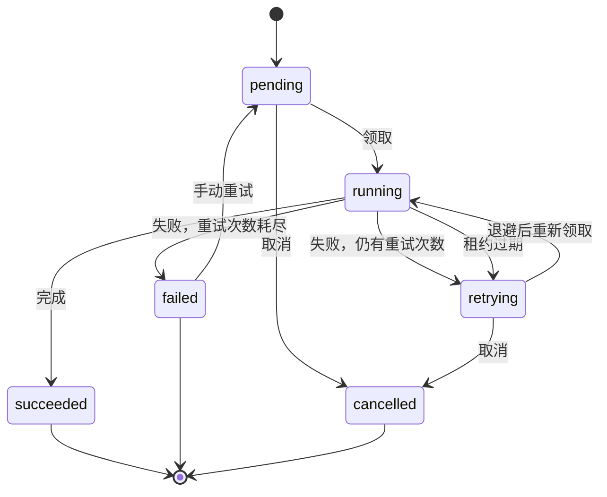

# 异步任务设计

- **状态：** 评审草案（2026-11-23）
- **细化：** [ADR-0008](../adr/ADR-0008-internal-api-and-worker.md)、[ADR-0009](../adr/ADR-0009-async-job-model.md)
- **来源：** [技术设计](../game-platform-technical-design.md)第 8 节；[schema.sql](../database/schema.sql) 中的 `system.background_jobs`、`system.outbox_events`、`operation.reward_jobs` 表

若本文档与 ADR 冲突，以 ADR 为准。标记为**（提案）**的内容未在设计文档或 ADR 中说明，尚待确认。

## 1. 异步处理范围

批量邮件投递、批量奖励发放、统计、排行榜重建、过期数据清理、存档快照、配置缓存刷新和失败任务重试。以上工作均不得在 HTTP 请求中执行。

V1 使用 PostgreSQL 作为任务队列，不使用消息代理。

## 2. 组成部分

| 部分 | 数据表或进程 | 用途 |
|---|---|---|
| 任务队列 | `system.background_jobs` | 保存待执行工作、状态、重试信息和租约 |
| Outbox | `system.outbox_events` | 仅当业务事务提交后才需要发布的事件 |
| 批处理业务记录 | `operation.reward_jobs` | 记录运营人员的请求和进度计数，并关联后台任务 |
| 执行器 | `game-worker` | 领取任务并在进程内调用 `gamecore` |

任务或 Outbox 记录与触发它们的业务变更在同一事务中插入。若事务回滚，任务也不会存在。

## 3. 任务状态



## 4. 领取任务

```sql
UPDATE system.background_jobs
SET status = 'running',
    lease_owner = $1,
    lease_expires_at = now() + make_interval(secs => $2),
    heartbeat_at = now(),
    started_at = COALESCE(started_at, now())
WHERE id = (
    SELECT id FROM system.background_jobs
    WHERE status IN ('pending', 'retrying') AND run_at <= now()
    ORDER BY priority DESC, run_at
    FOR UPDATE SKIP LOCKED
    LIMIT 1
)
RETURNING *;
```

`SKIP LOCKED` 允许多个 Worker 实例并发领取而不互相阻塞。部分索引 `background_jobs_claim_idx` 用于加速内部查询。

## 5. 租约、心跳与重新领取

- 领取任务时设置租约（**提案：** 60 秒）。
- Worker 执行期间刷新 `heartbeat_at` 和 `lease_expires_at`（**提案：** 每 20 秒一次）。
- 每个 Worker 都会运行清理检查，将租约过期的 `running` 任务改为 `retrying`，并递增 `retry_count`。Worker 崩溃后，最多经过一个租约周期就会释放任务。
- Worker 发现自己已失去租约时，应停止处理，且不得将任务标记为完成。

## 6. 重试与退避

- 每个任务独立设置 `max_retries`（Schema 默认值为 5）。
- **（提案）** 退避规则：`run_at = now() + min(base × 2^retry_count, cap)`，其中 `base = 10 s`、`cap = 15 min`，再加入最多 20% 的抖动。
- 失败时保存 `last_error`。当 `retry_count` 达到 `max_retries` 时，任务状态改为 `failed`。
- 不可能通过重试成功的错误（如校验失败、目标缺失）应立即失败。
- 运营人员可在 GM 控制台重试失败任务或取消待处理任务；两项操作都需审计。设计要求支持手动重试，但 GM API 尚无对应端点。

## 7. 幂等执行

投递语义为至少一次。每个处理器重复执行时都必须产生相同结果。

| 任务 | 重复执行时不产生副作用的机制 |
|---|---|
| 邮件投递 | `operation.player_mail` 上的 `UNIQUE (game_id, mail_id, player_id)`；使用 `ON CONFLICT DO NOTHING` 插入 |
| 批量奖励 | 流水唯一键，`source_type = 'reward_job'`，`source_id` 为奖励任务 ID |
| 统计 | 对 `(game_id, stat_date)` 或 `(game_id, stat_date, player_id)` 执行 upsert |
| 排行榜快照 | `UNIQUE (game_id, board_id, period_key)` |
| 存档快照 | `UNIQUE (game_id, player_id, save_version)` |
| 清理 | 删除已删除的行不会造成额外变化 |
| 入队 | `(job_type, dedupe_key)` 上的 `background_jobs_dedupe_uniq` 防止相同任务重复入队 |

## 8. 大批量任务

涉及大量玩家的批处理使用一个任务分页执行，而不是每位玩家创建一个任务。

1. 任务载荷保存目标定义和游标（上次处理的玩家 ID）。
2. 每轮载入一页（**提案：** 500 名玩家），在一个事务中处理；更新任务载荷中的游标和 `operation.reward_jobs` 计数器，然后发送心跳。
3. 崩溃后，下一个领取者从已保存的游标继续。中断页中的玩家会再次尝试处理，并由上述幂等键去重。

`reward_jobs.target_count`、`processed_count` 和 `failed_count` 用于向运营人员展示进度。

## 9. 任务目录

| `job_type` | 创建方 | 说明 |
|---|---|---|
| `mail_delivery` | `gm-api`，发送邮件时 | 由 `reward_jobs` 关联 |
| `batch_reward` | `gm-api` | 由 `reward_jobs` 关联 |
| `compensation` | `gm-api` | 由 `reward_jobs` 关联 |
| `stats_aggregation` | 调度器 | 填充 `analytics.daily_game_stats` 和 `daily_player_stats` |
| `leaderboard_rebuild` | 调度器或运营人员 | 从 `leaderboard_entries` 重建 Redis 读取模型，并写入周期快照 |
| `save_snapshot` | 调度器 | 写入 `player_save_snapshots` |
| `expired_data_cleanup` | 调度器 | 清理过期会话、幂等键、广告会话及超过保留期的已结束任务 |
| `config_cache_refresh` | 配置发布时的 Outbox | 刷新缓存和 CDN |

前三项与 `operation.reward_jobs` 的 `job_type` 检查约束一致；后五项与 `POST /internal/v1/maintenance/tasks` 的任务类型一致。

**（提案）** 由 `game-worker` 内部调度：轻量调度器使用 `stats_aggregation:2026-11-23` 等 `dedupe_key` 入队周期任务，避免多个 Worker 实例重复入队。

## 10. Outbox

- 业务事务插入一条 `outbox_events` 记录（`aggregate_type`、`aggregate_id`、`event_type`、`payload`）。
- Worker 按 `next_attempt_at` 顺序轮询未发布记录并逐条处理（V1 中用于创建任务或刷新缓存），随后设置 `published_at`。
- 失败时递增 `attempts`，保存 `last_error`，并按任务相同的退避规则推迟 `next_attempt_at`。
- 消费方必须能够处理重复事件。

V1 中 Outbox 没有外部订阅方。设置 Outbox 是为了确保“配置发布已提交”和“缓存刷新已请求”不会产生状态分歧或丢失；未来接入消息代理时，无需更改业务代码。

## 11. Worker 与内部 API

`game-worker` 直接调用 `gamecore`。它不使用 V1 未部署的 `internal-api`。`internal-api.yaml` 中的任务控制操作（`claim`、`heartbeat`、`complete`、`fail`）为未来部署在本模块之外的 Worker 描述相同的状态机。

## 12. 运维指标

| 指标 | 用途 |
|---|---|
| 按 `job_type` 和状态统计的队列深度 | 监控积压 |
| 最早的 `pending` 或 `retrying` 任务的等待时间 | 发现队列停滞 |
| 按 `job_type` 统计的执行时间 | 调整租约和分页大小 |
| 按 `job_type` 统计的失败与重试次数 | 发现处理器或数据问题 |
| 被重新领取的租约数量 | 发现 Worker 崩溃或过载 |
| 未发布 Outbox 记录数及最早记录的等待时间 | 发现 Outbox 停滞 |

完成的任务和已发布的 Outbox 记录在保留期后由 `expired_data_cleanup` 删除（**提案：** 30 天）。轮询会增加数秒延迟（**提案：** 空闲时每 2 秒轮询一次）；对这些任务类型可以接受。

## 13. 扩展条件

只有当实测吞吐量、延迟或扇出规模超过轮询能力时，才通过新 ADR 引入消息代理。
