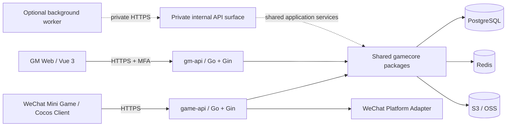

# Game Platform — Architecture Decisions

**Status:** Accepted baseline  
**Version:** 1.0  
**Date:** 2026-11-23  
**Scope:** MVP for WeChat Mini Games, with multi-platform extension points.

## 1. Context and goals

Build a reusable backend and operations platform for multiple small games. The first release supports WeChat Mini Games. Every game has its own player account namespace. The server is authoritative for durable/high-value state; moment-to-moment combat simulation may run on the client. The platform includes player APIs, GM APIs, configuration, economy, ads, operations, and audit.

Non-goals for MVP: real-time authoritative combat servers, cross-game shared player accounts, microservice-per-domain deployment, mandatory message broker, and Kubernetes-first deployment.

## 2. Logical architecture



The diagram is logical. The internal API is a private contract for future independently deployed workers/integrations; it is not a third public API service in MVP.

## ADR-001 — Two independently deployed API processes, shared modular core

**Status:** Accepted

**Decision**
- Deploy `game-api` and `gm-api` as separate Go + Gin applications.
- Keep domain and application services in shared `gamecore` packages in one Go module.
- Each process owns its HTTP router, handlers, DTOs, middleware, configuration, health checks, image, and deployment lifecycle.
- Both call application services directly in-process. Do not make game-api call gm-api or vice versa.
- Start as a modular monolith, not a network of domain microservices.

**Rationale**
Separate deployment prevents GM traffic, attack surface, and release cadence from being coupled to the player ingress. A shared core avoids duplicated business rules and distributed transactions.

**Consequences**
- A domain change may require rebuilding both binaries.
- Shared code must not contain transport-specific assumptions.
- Use explicit caller/authorization context in every application-service call.
- Split a domain into a separate service only after independent scaling, ownership, or isolation requirements justify the operational cost.

## ADR-002 — Platform internal API is a private boundary, not a third MVP service

**Status:** Accepted

**Decision**
- Define a separate OpenAPI document for internal service-to-service operations.
- In MVP, do not deploy a standalone `platform-internal-api` service and do not expose internal routes through the public ingress.
- If a background worker or external trusted platform component must cross a process boundary, expose a private listener/route group with network policy and workload authentication (mTLS preferred; short-lived service JWT acceptable where mTLS is unavailable).
- Internal endpoints call the same application services and enforce service identity, game scope, operation scope, request expiry, and idempotency.
- Internal API is not a bypass around player or GM authorization. It cannot accept caller-supplied `game_id` without validating the service's grant.

**MVP internal contract**
- `GET /internal/v1/health/ready`: readiness for orchestrators on a private listener.
- `POST /internal/v1/jobs/{jobId}/execute`: reserved for a future worker executor; disabled until a worker runtime is deployed.
- `POST /internal/v1/events/ingest`: reserved for trusted internal event producers; disabled until producer identity and quotas are provisioned.

Do not create internal endpoints merely to wrap a function already callable through gamecore. Do not expose internal OpenAPI to clients or public API gateways.

**Authentication and authorization**
- Prefer mTLS workload identity at the ingress/service mesh boundary.
- If JWT is used, validate issuer, audience, expiry, not-before, key rotation, service subject, and explicit scopes.
- Require `X-Request-ID`; mutations require `Idempotency-Key`.
- Internal service credentials are separate from player and GM signing keys.
- Private networking is defense in depth, not authentication.

## ADR-003 — Game-scoped player identity and platform adapters

**Status:** Accepted

**Decision**
- A player is scoped by `game_id`; each game has independent player accounts.
- External identity uniqueness is `(game_id, platform, app_id, openid)`.
- WeChat `unionid` may be stored as an attribute for diagnostics/linking, but must not silently merge players across games.
- Resolve the game from trusted application configuration/client credential mapping, not an arbitrary client-provided game_id.
- Keep provider-specific login in an adapter interface (for example `IdentityProvider.ExchangeCode`); persist normalized identity records in the shared core.

**WeChat login flow**
1. Client calls `wx.login()` and sends the temporary code to game-api.
2. Server selects the configured WeChat app for the resolved game and exchanges code with `jscode2session`.
3. Server maps/creates the game-scoped player and issues platform-owned access/refresh tokens.
4. Never return app secret or WeChat session_key to the client. Store secrets in a secret manager.

**Consequences**
Adding another mini-game platform requires an adapter and app configuration, not a new player model.

## ADR-004 — Server authority for durable state; client-run combat is untrusted

**Status:** Accepted

**Decision**
- Server owns wallets, paid/premium currency, inventory, permanent unlocks, mail/activity claims, settlement eligibility, and durable progression.
- Client may simulate moment-to-moment combat and submit a run result summary.
- The server validates run ownership, run state, expiry, one-time settlement, configuration version, reward bounds, costs, and idempotency.
- Client-submitted score, win flag, elapsed time, and reward are untrusted inputs. Never accept a client-calculated reward or balance.
- For valuable rewards, use server-verifiable challenges, replay/simulation, signed checkpoints, or conservative reward caps. If the client owns all simulation, anti-cheat cannot be made cryptographically complete.

**Economy invariants**
- Store currency as integer minor units.
- Every balance mutation and immutable ledger entry commit in one database transaction.
- Unique source/idempotency constraints prevent duplicate grants.
- Never allow GM or player handlers to directly set wallet balances; use a ledger-backed application service.

## ADR-005 — PostgreSQL is authoritative; Redis and object storage are non-authoritative

**Status:** Accepted

**Decision**
- PostgreSQL stores durable identity, player, config metadata, gameplay settlement, economy ledger, operations, RBAC, and audit data.
- Redis is used for cache, rate limiting, short-lived sessions/coordination, and derived leaderboard acceleration. Redis loss must not corrupt durable ownership or balances.
- S3/OSS + CDN stores large versioned configuration payloads and static assets. PostgreSQL stores metadata, checksums, release state, and object keys.
- Use one PostgreSQL database initially, with schemas by domain. Every game-owned business row carries `game_id`.
- Enforce cross-game references with composite keys/FKs wherever applicable.

## ADR-006 — Separate player and GM security planes

**Status:** Accepted

**Decision**
- Player tokens and GM sessions use separate issuers/audiences/signing keys and independent revocation/session stores.
- GM authentication supports MFA; privileged actions require RBAC permission codes and explicit game scope.
- GM API uses deny-by-default authorization. Roles are permission bundles; authorization is evaluated as (admin, permission, game scope).
- GM mutations append an audit record with actor, game, action, target, reason/ticket, request_id, before/after or redacted diff, and timestamp.
- High-risk actions (manual grants, account recovery, bulk sends, config release) may require dual approval according to policy.
- Player API must not expose GM endpoints; GM API must not accept player credentials.

**Database roles**
- Separate runtime roles for game-api, gm-api, and future worker; no superuser/BYPASSRLS.
- Migration role is separate and used only by deployment jobs.
- Runtime roles receive only required schema/table/function privileges.
- RLS may provide defense in depth, but application authorization and explicit tenant/game scope remain mandatory. Never rely on RLS alone where a privileged role can bypass it.

## ADR-007 — API contract and compatibility

**Status:** Accepted

**Decision**
- Use OpenAPI 3.1 as the contract source.
- Maintain three documents: player, GM, and private internal API. Common schemas may be factored into a later shared component package, but security scopes remain distinct.
- Version public routes under `/api/v1` and GM routes under `/gm/v1`; internal routes under `/internal/v1`.
- Mutating requests support `Idempotency-Key`; save updates use `If-Match`/ETag.
- Use cursor pagination for unbounded collections.
- Every response includes a request identifier; errors use a stable machine-readable code.
- Do not silently break clients: additive optional fields are preferred; breaking changes require a new API version.

## ADR-008 — Deployment and asynchronous work

**Status:** Accepted

**Decision**
- Build and deploy game-api and gm-api independently. GM Web is a separate static frontend.
- Begin with Docker Compose or a simple managed container platform; Kubernetes is not an MVP prerequisite.
- Use PostgreSQL transactional outbox for durable asynchronous work. A lightweight worker polls/claims jobs initially; add a broker only when throughput/latency or fan-out justifies it.
- No Kafka/RocketMQ/NATS in the initial baseline.
- Both APIs are stateless; horizontal scaling is allowed after session/cache semantics are externalized.

## 3. Service responsibilities

| Component | Responsibility | Publicly reachable |
|---|---|---|
| game-api | WeChat login, player profile/save, config, runs, economy, ads, mail/activity, leaderboard | Yes |
| gm-api | GM auth, RBAC, player operations, config publishing, economy adjustments, operations, analytics, audit | Restricted |
| gm-web | Operator UI | Restricted |
| gamecore | Domain/application services, repositories, provider ports | No |
| internal API surface | Authenticated workload-to-workload operations | No |
| worker (future) | Outbox/jobs, aggregation, scheduled work | No |
| PostgreSQL | Durable source of truth | No |
| Redis | Cache/ephemeral state | No |
| S3/OSS | Config blobs/assets | CDN read only as appropriate |

## 4. Repository layout

```text
game-platform/
├── apps/
│   ├── game-client/                 # Cocos Creator / TypeScript
│   └── gm-web/                      # Vue 3 / TypeScript / Element Plus
├── services/
│   ├── game-api/
│   │   ├── cmd/server/main.go
│   │   └── internal/transport/http/
│   ├── gm-api/
│   │   ├── cmd/server/main.go
│   │   └── internal/transport/http/
│   └── worker/                      # future, only when needed
├── internal/
│   └── gamecore/
│       ├── domain/
│       ├── application/
│       ├── ports/
│       ├── adapters/
│       └── persistence/postgres/
├── migrations/
├── api/
│   └── openapi/
├── docs/
└── deploy/
```

Use one Go module at repository root initially. This allows both services to import root-level `internal/gamecore` under Go's internal visibility rules. Keep transport DTOs out of gamecore.

## 5. Required security and reliability controls

- Resolve game/app identity server-side; reject unknown or disabled app mappings.
- Hash refresh tokens at rest; rotate on use and detect reuse.
- Rate-limit login, refresh, save, settlement, ad claim, and GM authentication.
- Enforce request body limits, timeouts, TLS, structured logs, trace/request IDs, and secret redaction.
- Use database constraints as the final defense for uniqueness, balance non-negativity, and idempotency.
- Apply bounded retries only to retry-safe operations.
- Never put access tokens, WeChat codes, session keys, app secrets, or raw personal identifiers in logs.
- Back up PostgreSQL and object storage metadata; regularly test restore and point-in-time recovery.
- GM API should be behind VPN/Zero Trust or IP allowlist where operationally feasible, plus MFA and WAF/rate limits.

## 6. Open questions to resolve before production

1. WeChat app credential rotation and ownership process.
2. Whether any game needs paid currency and corresponding refund/chargeback workflows.
3. Exact retention/legal policy for player identifiers, event data, and audit logs.
4. Whether high-value combat rewards require server replay or signed challenge protocol.
5. Whether GM high-risk operations require dual approval from day one.
6. Target regions, RPO/RTO, data residency, and expected concurrency.

These are explicit implementation gates; do not invent defaults in production configuration.
