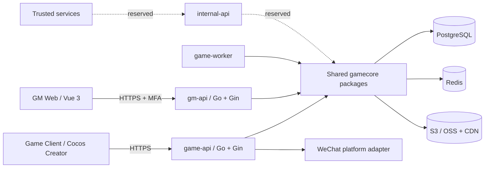

# Game Platform — Architecture overview and ADR index

**Status:** Accepted baseline  
**Version:** 2.0 (replaces 1.0)  
**Date:** 2026-11-23  
**Scope:** V1 for WeChat Mini Games, with multi-platform extension points.

The decisions themselves now live in one file per ADR under [`docs/adr/`](../adr/). This document keeps the cross-cutting overview and the index. The full design narrative is in the [technical design](../game-platform-technical-design.md).

## 1. Context and goals

Build a reusable backend and operations platform for multiple small games. The first release supports WeChat Mini Games. Every game has its own player account namespace. The server is authoritative for key data; moment-to-moment combat runs on the client. V1 delivers the player API, the GM API, a complete GM platform (administrators, RBAC, player and economy management, config centre, mail, activities, audit, basic operations data) and a background worker.

Non-goals for V1: payments, real-time combat servers, cross-game shared player accounts, microservice-per-domain deployment, a message broker (Kafka / RocketMQ), and Kubernetes.

## 2. What changed from baseline 1.0

| Topic | 1.0 | 2.0 |
|---|---|---|
| Worker | Future, optional; would call a private internal API over HTTPS | `game-worker` is a V1 component that calls `gamecore` in-process |
| Internal API | Private route group / listener, three reserved endpoints | Reserved `internal-api` entry with a nine-endpoint contract; not deployed in V1; HMAC AK/SK or mTLS |
| GM platform | Core workflows first, console in a later phase | Complete GM platform from V1 |
| ADR layout | Eight ADRs in this file | Nine ADR files under `docs/adr/` |
| Player contract file | `api/openapi/player-api.yaml` | `api/openapi/game-api.yaml` |
| Schema | 37 tables | 57 tables, renamed to the `schema.table` names of the design document. The 20 new tables: game environments, login records, player bans, config release items, run events, currency definitions, daily ad limits, announcements, mail attachments, reward jobs, leaderboard snapshots, admin sessions, admin MFA, service audit logs, daily player and game stats, background jobs, service identities, credentials and game grants |
| Third-party callbacks | Not addressed | Separate `/platform-callbacks/v1` surface with per-platform verification |

## 3. Logical architecture



Solid lines are V1. Dotted lines are reserved: `internal-api` has a contract and a service-auth abstraction but is not deployed.

## 4. ADR index

| ADR | Decision | Replaces (1.0) |
|---|---|---|
| [ADR-0001](../adr/ADR-0001-modular-monolith.md) | Modular monolith: one Go module, shared `gamecore`, independently deployed entrypoints | ADR-001 |
| [ADR-0002](../adr/ADR-0002-game-isolation.md) | `game_id` is the isolation key, enforced by composite keys, explicit repository scope and separate database roles | Parts of ADR-003, ADR-005 |
| [ADR-0003](../adr/ADR-0003-player-account-model.md) | Per-game player accounts; WeChat login; platform tokens; platform adapter | ADR-003 |
| [ADR-0004](../adr/ADR-0004-data-authority-model.md) | Server authority for key data; client-run combat with server settlement; PostgreSQL authoritative | ADR-004, part of ADR-005 |
| [ADR-0005](../adr/ADR-0005-api-service-boundaries.md) | Four entries and three security planes; `Actor` context; OpenAPI contracts; callbacks as a separate surface | ADR-006, ADR-007 |
| [ADR-0006](../adr/ADR-0006-postgresql-schema-design.md) | One database, schemas by domain, constraint and role conventions, migrations | ADR-005, part of ADR-006 |
| [ADR-0007](../adr/ADR-0007-economy-transaction-model.md) | Balance plus immutable ledger, idempotent single write path, GM adjustments | Part of ADR-004 |
| [ADR-0008](../adr/ADR-0008-internal-api-and-worker.md) | Worker calls `gamecore` directly; internal API reserved | ADR-002 |
| [ADR-0009](../adr/ADR-0009-async-job-model.md) | PostgreSQL-backed jobs and outbox; no broker | Part of ADR-008 |

Changing a decision means amending its ADR and having it reviewed before implementation. Implementation work must not silently rewrite an accepted ADR.

## 5. Component responsibilities

| Component | Responsibility | Reachable from | V1 |
|---|---|---|---|
| `game-api` | WeChat login, profile, save, config, runs and settlement, economy, ads, mail, activities, leaderboards, event upload | Public | Deployed |
| `gm-api` | GM auth and MFA, RBAC, games, players, economy adjustments, config publishing, mail, activities, announcements, leaderboards, analytics, audit | Restricted | Deployed |
| `gm-web` | Operator console (Vue 3 + TypeScript + Element Plus) | Restricted | Deployed |
| `game-worker` | Outbox and background jobs: batch mail and rewards, statistics, rebuilds, cleanup, snapshots | No inbound traffic | Deployed |
| `internal-api` | Authenticated service-to-service operations | Private network only | Reserved |
| `gamecore` | Domain model, application services, repositories | In-process only | — |
| PostgreSQL | Authoritative store | Private | — |
| Redis | Cache, rate limiting, leaderboard read acceleration | Private | — |
| S3/OSS + CDN | Config payloads, assets, save backups | CDN read where appropriate | — |

## 6. Repository layout

```text
game-platform/
├── apps/
│   ├── game-client/cocos/           # Cocos Creator + TypeScript
│   └── gm-web/                      # Vue 3 + TypeScript + Element Plus
├── services/
│   ├── game-api/cmd/server/main.go
│   ├── gm-api/cmd/server/main.go
│   ├── internal-api/cmd/server/main.go   # reserved; not deployed in V1
│   └── game-worker/cmd/worker/main.go
├── internal/
│   ├── gamecore/{domain,application,repository}/
│   ├── transport/http/{game,gm,internal}/
│   ├── security/{playerauth,adminauth,serviceauth}/
│   ├── platform/wechat/
│   ├── infrastructure/{postgres,redis,storage,observability}/
│   └── shared/
├── migrations/
├── api/{openapi,generated}/
├── deploy/{docker,compose,nginx,monitoring}/
├── docs/
├── AGENTS.md
└── go.mod                           # one Go module at the repository root
```

`gamecore` does not import Gin or any transport DTO. Entry packages under `internal/transport/http/*` do not import each other.

## 7. Required security and reliability controls

- Resolve game identity server-side; reject unknown or disabled platform apps. Never let a client switch games by sending a `game_id`.
- Hash refresh tokens at rest; rotate on use; support revocation.
- Rate-limit login, refresh, save, settlement, ad claim and GM authentication.
- Make every important write idempotent: identity creation at login, settlement, grants and spends, mail and activity claims, ad claims, GM adjustments, batch reward jobs. The final guarantee is a PostgreSQL unique key and transaction, not a Redis lock.
- Append an audit record for every GM mutation with operator, game, action, target, before/after data, reason and request ID; redact passwords, tokens and secrets.
- Structured JSON logs with `request_id`, `game_id`, `player_id`, route, status and latency. Never log AppSecret, refresh tokens, full `Authorization` headers or WeChat `session_key`.
- Back up PostgreSQL and test restore; keep a backup and recovery runbook.
- Place `gm-api` behind VPN, Zero Trust or an IP allowlist where feasible, in addition to MFA and rate limits.

## 8. Open questions to resolve before production

1. WeChat app credential rotation and ownership process.
2. Which process hosts `/platform-callbacks/v1`, and whether any callback is built in V1 at all. Scenarios and options are in [service-boundaries.md](service-boundaries.md#5-third-party-callbacks); ADR-0005 assumes a route group in `game-api`.
3. Whether to adopt WeChat's optional server-side verification for rewarded ads in V1. WeChat documents the mode (<https://developers.weixin.qq.com/minigame/dev/guide/security/antiadcheat.html>); its request fields and signature scheme have not been reviewed here. Adopting it needs a callback endpoint and a column on `ads.ad_sessions`.
4. Whether high-value combat rewards need server replay verification in the first game.
5. The amount threshold at which GM adjustments require dual approval, and when that enhancement ships.
6. Retention policy for player identifiers, event data, ledgers and audit logs.
7. Target regions, RPO/RTO, data residency and expected concurrency.
8. GM refresh-token lifetime (left to security policy in ADR-0003).
9. The role-to-permission mapping in [rbac-matrix.md](../security/rbac-matrix.md) and the grant matrix in [database-roles-and-grants.md](../database/database-roles-and-grants.md) are proposals awaiting confirmation.
10. Items marked **(proposal)** in the topic documents: session denylist, refresh-token reuse detection, wallet write path (repository discipline or `SECURITY DEFINER` function), first RLS tables, backoff and lease values.
11. Endpoints the GM menu implies but the API table does not list: GM logout and MFA enrollment, item adjustments, batch rewards other than mail, list/edit/publish for activities and announcements, leaderboard creation and rebuild, job progress and manual retry. On the player side: marking mail as read.

These are implementation gates; do not invent production defaults for them.
