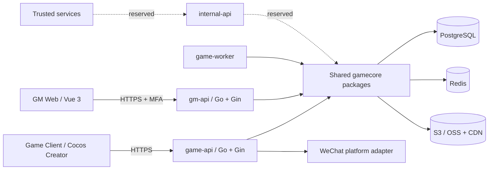

# 游戏平台 — 架构概览与 ADR 索引

**状态：** 已接受的基线
**版本：** 2.0（取代 1.0）
**日期：** 2026-11-23
**范围：** 面向微信小游戏的 V1，并预留多平台扩展点。

具体决策现按 ADR 分别存放于 [`docs/adr/`](../adr/)。本文保留跨领域概览和索引。完整设计说明见[技术设计](../game-platform-technical-design.md)。

## 1. 背景与目标

构建可复用的后端和运营平台，为多款小游戏提供服务。首个版本支持微信小游戏。每款游戏拥有独立的玩家账号命名空间。关键数据以服务端为权威；即时战斗由客户端运行。V1 提供玩家 API、GM API、完整 GM 平台（管理员、RBAC、玩家和经济管理、配置中心、邮件、活动、审计、基础运营数据）及后台 Worker。

V1 不包含：支付、实时战斗服务器、跨游戏共享玩家账号、按领域拆分并独立部署的微服务、消息代理（Kafka / RocketMQ）和 Kubernetes。

## 2. 相较 1.0 基线的变化

| 主题 | 1.0 | 2.0 |
|---|---|---|
| Worker | 未来可选组件；通过 HTTPS 调用私有内部 API | `game-worker` 是 V1 组件，在进程内调用 `gamecore` |
| 内部 API | 私有路由组/监听器，预留三个端点 | 预留 `internal-api` 入口及九个端点的契约；V1 不部署；使用 HMAC AK/SK 或 mTLS |
| GM 平台 | 先实现核心流程，后续阶段再建控制台 | V1 即提供完整 GM 平台 |
| ADR 布局 | 八项 ADR 集中在本文 | 九个 ADR 文件，位于 `docs/adr/` |
| 玩家 API 契约文件 | `api/openapi/player-api.yaml` | `api/openapi/game-api.yaml` |
| 数据库结构 | 37 张表 | 57 张表，表名改为设计文档中的 `schema.table` 形式。新增 20 张表：游戏环境、登录记录、玩家封禁、配置发布项、对局事件、货币定义、广告每日限额、公告、邮件附件、奖励任务、排行榜快照、管理员会话、管理员 MFA、服务审计日志、玩家和游戏每日统计、后台任务、服务身份、凭据和游戏授权 |
| 第三方回调 | 未涉及 | 独立的 `/platform-callbacks/v1` 入口，并按平台分别验证 |

## 3. 逻辑架构



实线表示 V1 已部署的部分。虚线表示预留部分：`internal-api` 有契约和服务认证抽象，但不会部署。

## 4. ADR 索引

| ADR | 决策 | 取代的 1.0 决策 |
|---|---|---|
| [ADR-0001](../adr/ADR-0001-modular-monolith.md) | 模块化单体：单一 Go 模块，共用 `gamecore`，入口独立部署 | ADR-001 |
| [ADR-0002](../adr/ADR-0002-game-isolation.md) | 以 `game_id` 为隔离键，通过复合键、显式 Repository 范围和独立数据库角色落实隔离 | ADR-003、ADR-005 的部分内容 |
| [ADR-0003](../adr/ADR-0003-player-account-model.md) | 玩家账号按游戏隔离；微信登录；平台令牌；平台适配器 | ADR-003 |
| [ADR-0004](../adr/ADR-0004-data-authority-model.md) | 关键数据由服务端权威管理；客户端运行战斗、服务端结算；PostgreSQL 为权威存储 | ADR-004、ADR-005 的部分内容 |
| [ADR-0005](../adr/ADR-0005-api-service-boundaries.md) | 四个入口和三个安全平面；`Actor` 上下文；OpenAPI 契约；回调独立接入 | ADR-006、ADR-007 |
| [ADR-0006](../adr/ADR-0006-postgresql-schema-design.md) | 单一数据库，按领域划分 Schema；约束、角色和迁移约定 | ADR-005、ADR-006 的部分内容 |
| [ADR-0007](../adr/ADR-0007-economy-transaction-model.md) | 余额与不可变流水；幂等的单一写入路径；GM 调账 | ADR-004 的部分内容 |
| [ADR-0008](../adr/ADR-0008-internal-api-and-worker.md) | Worker 直接调用 `gamecore`；内部 API 预留 | ADR-002 |
| [ADR-0009](../adr/ADR-0009-async-job-model.md) | 基于 PostgreSQL 的任务与 Outbox；不引入消息代理 | ADR-008 的部分内容 |
| [ADR-0010](../adr/ADR-0010-v1-decision-baseline.md) | 2026-11-24 确认的 V1 实施决策与发布门禁 | — |

变更决策时，必须修订对应 ADR，并在实施前完成评审。实施工作不得悄然改写已接受的 ADR。

## 5. 组件职责

| 组件 | 职责 | 可从何处访问 | V1 状态 |
|---|---|---|---|
| `game-api` | 微信登录、玩家资料、存档、配置、对局和结算、经济系统、广告、邮件、活动、排行榜、事件上传 | 公网 | 部署 |
| `gm-api` | GM 认证和 MFA、RBAC、游戏、玩家、经济调账、配置发布、邮件、活动、公告、排行榜、分析、审计 | 受限网络 | 部署 |
| `gm-web` | 运营管理控制台（Vue 3 + TypeScript + Element Plus） | 受限网络 | 部署 |
| `game-worker` | Outbox 和后台任务：批量邮件与奖励、统计、重建、清理、快照 | 不接收入站流量 | 部署 |
| `internal-api` | 已认证的服务间操作 | 仅限私有网络 | 预留 |
| `gamecore` | 领域模型、应用服务、Repository | 仅进程内 | — |
| PostgreSQL | 权威存储 | 私有网络 | — |
| Redis | 缓存、限流、排行榜读取加速 | 私有网络 | — |
| S3/OSS + CDN | 配置负载、资源和存档备份 | 适用时允许 CDN 读取 | — |

## 6. 仓库布局

```text
game-platform/
├── apps/
│   ├── game-client/cocos/           # Cocos Creator + TypeScript
│   └── gm-web/                      # Vue 3 + TypeScript + Element Plus
├── services/
│   ├── game-api/cmd/server/main.go
│   ├── gm-api/cmd/server/main.go
│   ├── internal-api/cmd/server/main.go   # 预留；V1 不部署
│   └── game-worker/cmd/worker/main.go
├── internal/
│   ├── gamecore/{domain,application,repository}/
│   ├── transport/http/{game,gm,internal}/
│   ├── security/{playerauth,adminauth,serviceauth}/
│   ├── platform/wechat/
│   ├── infrastructure/{postgres,redis,storage,observability}/
│   └── shared/
├── migrations/
├── api/{openapi,generated}/
├── deploy/{docker,compose,nginx,monitoring}/
├── docs/
├── AGENTS.md
└── go.mod                           # 仓库根目录的唯一 Go 模块
```

`gamecore` 不得导入 Gin 或任何传输层 DTO。`internal/transport/http/*` 下的入口包不得互相导入。

## 7. 必须落实的安全与可靠性控制

- 在服务端解析游戏身份；拒绝未知或停用的平台应用。绝不允许客户端通过传入 `game_id` 切换游戏。
- Refresh token 静态存储时必须哈希；使用时轮换，并支持撤销。
- 对登录、令牌刷新、存档、结算、广告领取和 GM 认证限流。
- 所有重要写入都必须幂等：登录身份创建、结算、发放与扣除、邮件和活动领取、广告领取、GM 调账、批量奖励任务。最终保障依赖 PostgreSQL 唯一键和事务，而不是 Redis 锁。
- 每次 GM 变更都追加审计记录，包含操作员、游戏、操作、目标、变更前后数据、原因和请求 ID；密码、令牌和密钥必须脱敏。
- 使用结构化 JSON 日志，并记录 `request_id`、`game_id`、`player_id`、路由、状态和延迟。绝不记录 AppSecret、refresh token、完整 `Authorization` 请求头或微信 `session_key`。
- 备份 PostgreSQL 并测试恢复；维护备份与恢复手册。
- 在可行时，将 `gm-api` 部署在 VPN、零信任网络或 IP 允许列表之后，并同时启用 MFA 和限流。

## 8. V1 实施决策与发布门禁

2026-11-24 确认的 11 项决策见 [ADR-0010](../adr/ADR-0010-v1-decision-baseline.md)。各子系统的范围、契约和验收任务见[实施路线图](../implementation/roadmap.md)。

- 生产前确认目标市场、最终数据保留与删除规则、数据驻留要求、部署区域和峰值并发。
- 高价值玩法上线前确定校验方式与奖励上限。
- 其余标为**提案**的细节在对应实施阶段评审。生产发布须通过数据库授权与游戏隔离、API 契约、恢复演练和负载验收。
