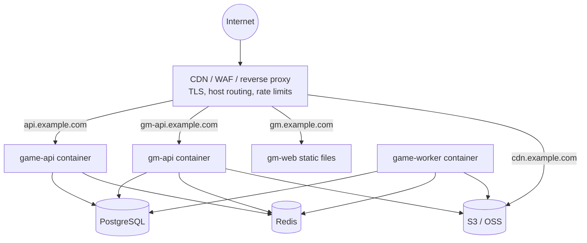

# Deployment architecture

- **Status:** Draft for review (2026-11-23)
- **Elaborates:** [ADR-0001](../adr/ADR-0001-modular-monolith.md), [ADR-0006](../adr/ADR-0006-postgresql-schema-design.md), [ADR-0008](../adr/ADR-0008-internal-api-and-worker.md)
- **Source:** sections 2.2, 10 and 11.3 of the [technical design](../game-platform-technical-design.md)

Where this document and an ADR disagree, the ADR wins. Items marked **(proposal)** are not stated in the design document or an ADR and need confirmation.

## 1. Topology

`internal-api` is not deployed. When it is, it listens on the private network only (`internal.example.com`) and is never routed through the public edge.

## 2. Services

| Service | Image | Public | Replicas (V1) | Notes |
|---|---|---|---|---|
| `game-api` | `game-platform/game-api` | Yes, through the edge | 1 or more; stateless | Bound to `127.0.0.1:8081` behind the proxy |
| `gm-api` | `game-platform/gm-api` | Restricted | 1; stateless | Bound to `127.0.0.1:8082`; VPN, Zero Trust or IP allowlist where feasible |
| `gm-web` | `game-platform/gm-web` | Restricted | 1 | Static files on Nginx or a CDN; bound to `127.0.0.1:8083` |
| `game-worker` | `game-platform/game-worker` | No inbound traffic | 1 or more | Several instances are safe because claims use `SKIP LOCKED` |
| PostgreSQL | Managed service preferred | No | — | Not required to share a host with the application |
| Redis | Managed service preferred | No | — | Loss must not affect ownership or balances |
| S3 / OSS + CDN | Cloud service | CDN read only | — | Config payloads, assets, save backups |

The Compose file in section 10.2 of the design is the starting point. It uses the `latest` tag; production pins image versions.

## 3. Configuration and secrets

Configuration comes from environment variables and mounted files. Secrets come from the secret store and are never committed.

| Setting | game-api | gm-api | game-worker |
|---|---|---|---|
| `APP_ENV`, `HTTP_ADDR` | Yes | Yes | `APP_ENV` only |
| Database DSN for its own runtime role | `game_api_runtime` | `gm_api_runtime` | `game_worker_runtime` |
| Redis address and credentials | Yes | Yes | Yes |
| Object storage credentials | Read | Read and write (config payloads) | Read and write (snapshots, exports) |
| Player token signing keys | Yes | No | No |
| GM token signing keys | No | Yes | No |
| MFA encryption key reference | No | Yes | No |
| WeChat app secrets (through `credential_ref`) | Yes | No | Only if a job calls WeChat |

The variable names are fixed in T04. The table states which process may hold which secret; a process never receives a secret of another plane.

## 4. Database roles

| Role | Used by | Kind |
|---|---|---|
| `game_platform_owner` | Nobody at runtime; owns the objects | `NOLOGIN` |
| `game_migrator` | The migration job only | `LOGIN`, member of the owner role |
| `game_api_runtime` | `game-api` | `LOGIN`, least privilege |
| `gm_api_runtime` | `gm-api` | `LOGIN`, least privilege |
| `game_worker_runtime` | `game-worker` | `LOGIN`, least privilege |

Grants are in [database-roles-and-grants.md](../database/database-roles-and-grants.md). No runtime role is an owner or a superuser.

## 5. Migrations

- Migrations are forward-only files under `/migrations`, applied by a dedicated job with the `game_migrator` credentials.
- **(proposal)** The job runs before new application containers start and is a separate step of the deployment pipeline, not something an API process does on boot. Application containers never hold migration credentials.
- Schema changes follow expand and contract: add first, deploy code that works with both shapes, remove later. This keeps a rollback of the application image possible.
- A migration is validated on staging before production.

## 6. Health and shutdown

| Endpoint | Meaning |
|---|---|
| Liveness | The process is running |
| Readiness | Database reachable, migrations at the expected version, Redis reachable or degraded mode accepted |

**(proposal)** Paths `/healthz` and `/readyz` on each API, outside the versioned API prefix and not exposed through the public edge. The worker exposes the same on a local port for the container health check.

On `SIGTERM` an API stops accepting new requests and finishes in-flight ones within a timeout. The worker stops claiming, finishes or releases its current job, and exits; an unreleased job is recovered when its lease expires.

## 7. Environments

| Environment | Database | WeChat app |
|---|---|---|
| Development | Own database | Test configuration |
| Staging | Own database | Test AppID |
| Production | Own database | Production AppID |

Each environment also has its own Redis, bucket and secrets. Test and production never share player data. Production data is copied elsewhere only after anonymization.

## 8. Observability

- Logs: JSON on stdout with `timestamp`, `level`, `service`, `request_id`, `game_id`, `player_id`, `route`, `status`, `latency_ms`; collected by the platform's log agent.
- Metrics: Prometheus scrapes each service; Grafana dashboards per area (API, auth, database, Redis, economy, gameplay, worker, GM, business).
- Traces: OpenTelemetry, with the `request_id` attached to spans.
- Never logged: AppSecret, refresh tokens, full `Authorization` headers, WeChat `session_key`.

## 9. Backup and recovery

- PostgreSQL: scheduled backups with point-in-time recovery; restore is rehearsed before launch and on a schedule.
- Object storage: bucket versioning for config payloads.
- Redis: no backup required; it is rebuilt.
- RPO, RTO and regions are open questions listed in [decisions.md](decisions.md).

## 10. Before production

The design lists what the Compose baseline still lacks. Each is a release condition:

- [ ] Database connection pool configuration per service.
- [ ] Container health checks.
- [ ] Resource limits.
- [ ] Secret injection from the secret store.
- [ ] Containers run as a non-root user.
- [ ] Log collection.
- [ ] Pinned image and dependency versions.
- [ ] A defined migration execution strategy (section 5).
- [ ] Backup and restore runbook.

## 11. Rollout order (proposal)

1. Apply migrations (expand step).
2. Deploy `game-worker`, then `gm-api`, then `game-api`. The worker goes first so that queued jobs written by new API code are understood.
3. Deploy `gm-web`.
4. Verify readiness, error rate and queue depth.
5. Contract-step migrations go out in a later release.

Roll back by redeploying the previous images; the expand-only schema still serves them.

## 12. Moving to Kubernetes later

Nothing in V1 depends on Compose: each process is stateless, configured through the environment, has health endpoints and handles `SIGTERM`. A later move maps services to Deployments, the migration step to a Job, and secrets to the cluster's secret mechanism. That move needs its own ADR.
