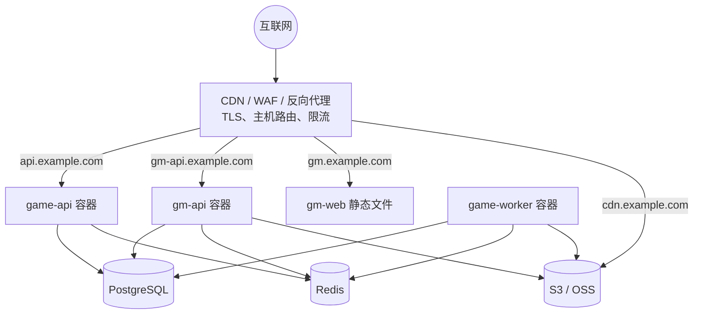

# 部署架构

- **状态：** 评审草案（2026-11-23）
- **细化：** [ADR-0001](../adr/ADR-0001-modular-monolith.md)、[ADR-0006](../adr/ADR-0006-postgresql-schema-design.md)、[ADR-0008](../adr/ADR-0008-internal-api-and-worker.md)
- **来源：** [技术设计](../game-platform-technical-design.md)第 2.2、10 和 11.3 节

若本文档与 ADR 冲突，以 ADR 为准。标记为**（提案）**的内容未在设计文档或 ADR 中说明，尚待确认。

## 1. 拓扑

不部署 `internal-api`。未来部署时，仅在私有网络（`internal.example.com`）监听，绝不通过公网边缘路由。

## 2. 服务

| 服务 | 镜像 | 公网访问 | V1 副本数 | 说明 |
|---|---|---|---|---|
| `game-api` | `game-platform/game-api` | 是，经公网边缘接入 | 1 个或更多；无状态 | 代理后绑定 `127.0.0.1:8081` |
| `gm-api` | `game-platform/gm-api` | 受限 | 1 个；无状态 | 绑定 `127.0.0.1:8082`；可行时配置 VPN、零信任网络或 IP 允许列表 |
| `gm-web` | `game-platform/gm-web` | 受限 | 1 个 | 通过 Nginx 或 CDN 提供静态文件；绑定 `127.0.0.1:8083` |
| `game-worker` | `game-platform/game-worker` | 无入站流量 | 1 个或更多 | 多实例可安全运行，因为使用 `SKIP LOCKED` 领取任务 |
| PostgreSQL | 优先使用托管服务 | 否 | — | 不要求与应用共用主机 |
| Redis | 优先使用托管服务 | 否 | — | 丢失不得影响所有权或余额 |
| S3 / OSS + CDN | 云服务 | 仅允许 CDN 读取 | — | 配置负载、资源和存档备份 |

技术设计第 10.2 节中的 Compose 文件是起点。该文件使用 `latest` 标签；生产环境必须固定镜像版本。

## 3. 配置与密钥

配置通过环境变量和挂载文件提供。密钥来自密钥管理器，绝不提交到版本库。

| 配置项 | game-api | gm-api | game-worker |
|---|---|---|---|
| `APP_ENV`、`HTTP_ADDR` | 是 | 是 | 仅 `APP_ENV` |
| 自身运行时角色的数据库 DSN | `game_api_runtime` | `gm_api_runtime` | `game_worker_runtime` |
| Redis 地址和凭据 | 是 | 是 | 是 |
| 对象存储凭据 | 只读 | 读写（配置负载） | 读写（快照、导出） |
| 玩家令牌签名密钥 | 是 | 否 | 否 |
| GM 令牌签名密钥 | 否 | 是 | 否 |
| MFA 加密密钥引用 | 否 | 是 | 否 |
| 微信应用密钥（通过 `credential_ref`） | 是 | 否 | 仅当任务需要调用微信时 |

变量名在 T04 中确定。此表规定各进程可以持有的密钥；任何进程都不得接收其他安全平面的密钥。

## 4. 数据库角色

| 角色 | 使用方 | 类型 |
|---|---|---|
| `game_platform_owner` | 运行时无人使用；拥有数据库对象 | `NOLOGIN` |
| `game_migrator` | 仅迁移任务 | `LOGIN`，属于所有者角色 |
| `game_api_runtime` | `game-api` | `LOGIN`，最小权限 |
| `gm_api_runtime` | `gm-api` | `LOGIN`，最小权限 |
| `game_worker_runtime` | `game-worker` | `LOGIN`，最小权限 |

授权详见[数据库角色与授权](../database/database-roles-and-grants.md)。运行时角色不得为对象所有者或超级用户。

## 5. 数据库迁移

- 迁移文件放在 `/migrations` 下，只向前执行，并由使用 `game_migrator` 凭据的专用任务应用。
- **（提案）** 在新应用容器启动前运行迁移任务，并将其作为部署流水线的独立步骤，而不是在 API 进程启动时运行。应用容器绝不持有迁移凭据。
- Schema 变更采用扩展/收缩流程：先添加，再部署兼容新旧结构的代码，最后移除旧结构。这样可以回滚应用镜像。
- 迁移须先在预发布环境验证，再应用到生产环境。

## 6. 健康检查与关闭

| 检查项 | 含义 |
|---|---|
| 存活状态 | 进程正在运行 |
| 就绪状态 | 数据库可访问、迁移版本符合预期；Redis 可访问或系统已接受降级模式 |

**（提案）** 每个 API 在版本化前缀之外提供 `/healthz` 和 `/readyz`，且公网边缘不可访问这些路径。Worker 在本地端口提供相同端点，供容器健康检查使用。

收到 `SIGTERM` 后，API 停止接受新请求，并在超时前处理完进行中的请求。Worker 停止领取任务，完成或释放当前任务后退出；未释放的任务会在租约过期后重新领取。

## 7. 环境

| 环境 | 数据库 | 微信应用 |
|---|---|---|
| 开发 | 独立数据库 | 测试配置 |
| 预发布 | 独立数据库 | 测试 AppID |
| 生产 | 独立数据库 | 生产 AppID |

每个环境还使用独立 Redis、存储桶和密钥。测试与生产绝不共享玩家数据。生产数据只能在匿名化后复制到其他环境。

## 8. 可观测性

- 日志：将 JSON 写到 stdout，字段包括 `timestamp`、`level`、`service`、`request_id`、`game_id`、`player_id`、`route`、`status`、`latency_ms`；由平台日志代理采集。
- 指标：Prometheus 抓取各服务指标；Grafana 按 API、认证、数据库、Redis、经济系统、玩法、Worker、GM 和业务领域提供仪表盘。
- 链路追踪：使用 OpenTelemetry，并将 `request_id` 附加到 span。
- 绝不记录：AppSecret、refresh token、完整 `Authorization` 请求头、微信 `session_key`。

## 9. 备份与恢复

- PostgreSQL：定期备份并支持时间点恢复；上线前及之后按计划演练恢复流程。
- 对象存储：为配置负载启用存储桶版本控制。
- Redis：无需备份，可从权威数据重建。
- RPO、RTO 和部署区域仍待确定，详见[决策文档](decisions.md)。

## 10. 生产环境上线前检查

设计中的 Compose 基线仍缺少以下内容；每项均为发布条件：

- [ ] 为每项服务配置数据库连接池。
- [ ] 配置容器健康检查。
- [ ] 设置资源限制。
- [ ] 从密钥管理器注入密钥。
- [ ] 容器使用非 root 用户运行。
- [ ] 配置日志采集。
- [ ] 固定镜像和依赖版本。
- [ ] 明确迁移执行策略（第 5 节）。
- [ ] 编写备份与恢复手册。

## 11. 发布顺序（提案）

1. 应用迁移（扩展步骤）。
2. 依次部署 `game-worker`、`gm-api`、`game-api`。Worker 先部署，以确保它能处理新 API 代码写入队列的任务。
3. 部署 `gm-web`。
4. 检查就绪状态、错误率和队列深度。
5. 后续发布再执行收缩步骤迁移。

回滚时重新部署上一版镜像；仅执行扩展步骤的 Schema 仍可兼容旧版本。

## 12. 未来迁移到 Kubernetes

V1 不依赖 Compose 的专有功能：各进程均无状态、通过环境配置、提供健康端点并处理 `SIGTERM`。未来可将服务映射为 Deployment、迁移步骤映射为 Job、密钥映射为集群密钥管理机制。该迁移需另行通过 ADR 决策。
