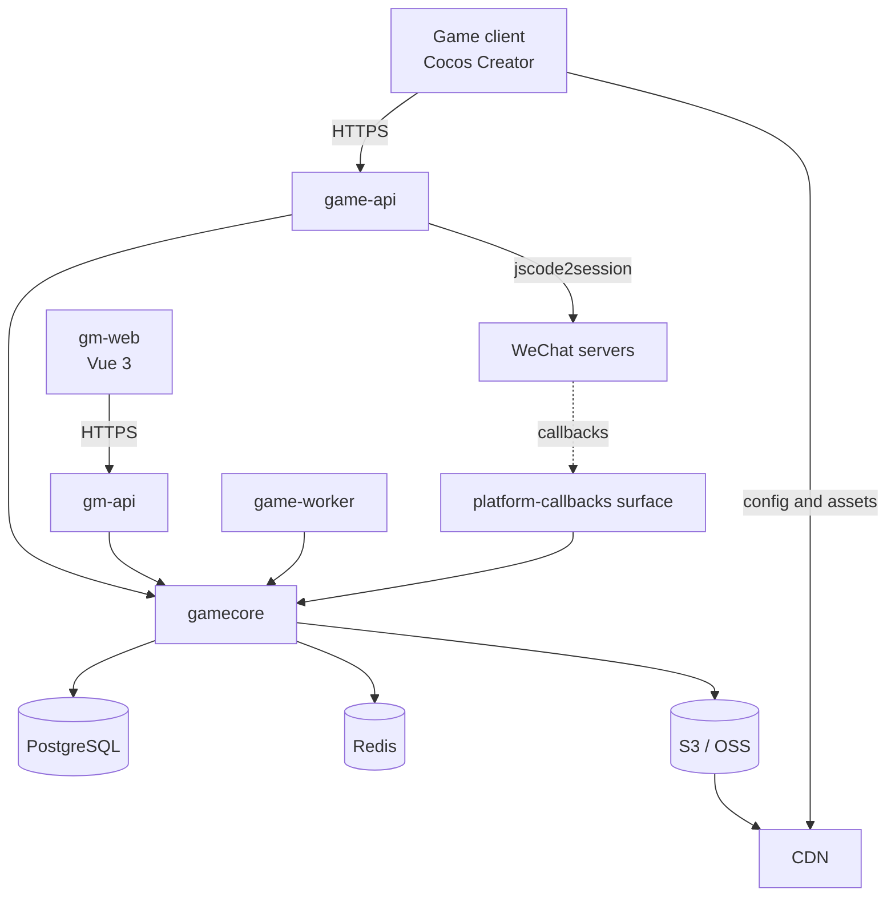
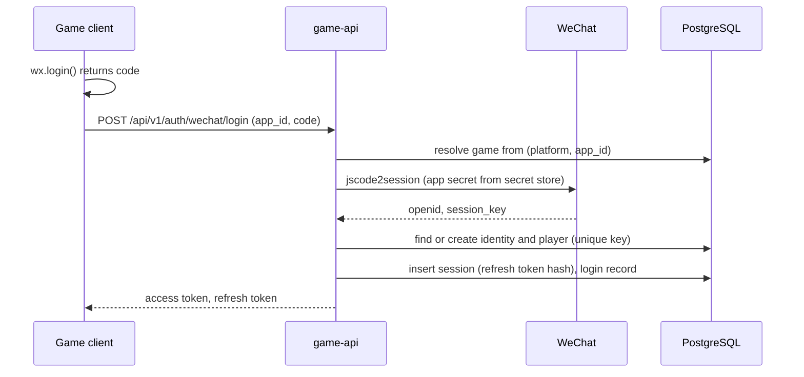
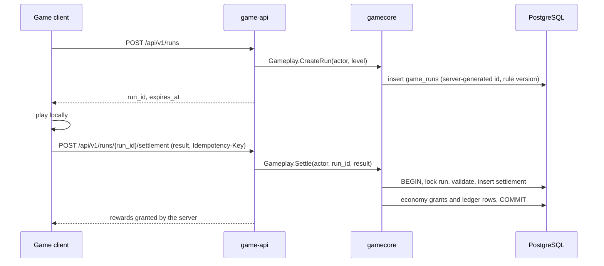

# System architecture

- **Status:** Draft for review (2026-11-23)
- **Elaborates:** [ADR-0001](../adr/ADR-0001-modular-monolith.md), [ADR-0005](../adr/ADR-0005-api-service-boundaries.md), [ADR-0008](../adr/ADR-0008-internal-api-and-worker.md)
- **Source:** sections 1, 2 and 15 of the [technical design](../game-platform-technical-design.md)

Where this document and an ADR disagree, the ADR wins. Items marked **(proposal)** are not stated in the design document or an ADR and need confirmation.

## 1. What the platform is

One backend that serves several small games. It does not implement any game's rules. It provides the capabilities every game needs: accounts, profile and save, configuration, run settlement, economy, ad rewards, mail, announcements, activities, leaderboards, a GM console, operations data, audit and background jobs.

V1 targets WeChat Mini Games. Other platforms (Douyin, Alipay, native Android/iOS) are reached later through a platform adapter.

## 2. Component view



| Component | Kind | Role | V1 |
|---|---|---|---|
| `game-api` | Go + Gin process | Player-facing HTTP API | Deployed |
| `gm-api` | Go + Gin process | Operator HTTP API | Deployed |
| `game-worker` | Go process, no inbound traffic | Outbox and background jobs | Deployed |
| `internal-api` | Go + Gin process | Service-to-service HTTP API | Reserved, not deployed |
| platform-callbacks surface | Route group | Inbound calls from WeChat and ad platforms | Hosting undecided; see [service boundaries](service-boundaries.md#5-third-party-callbacks) |
| `gamecore` | Go packages | The only implementation of business rules | In-process library |
| `gm-web` | Static Vue 3 app | Operator console | Deployed |
| `game-client` | Cocos Creator app | The game | Per game |
| PostgreSQL | Database | Authoritative business data, job queue | Managed service preferred |
| Redis | Cache | Cache, rate limiting, leaderboard read acceleration | Managed service preferred |
| S3 / OSS + CDN | Object storage | Config payloads, assets, save backups | Cloud service |

## 3. Layering inside the Go module

```text
services/<entry>/cmd        process wiring: config, logger, DB pool, router, shutdown
        │
internal/transport/http/<entry>   handlers, DTOs, routing        (one package tree per entry)
internal/security/<plane>         authentication and Actor construction
        │
internal/gamecore/application     use cases, transaction boundaries, authorization checks
internal/gamecore/domain          entities, value objects, invariants
internal/gamecore/repository      persistence interfaces and PostgreSQL implementations
        │
internal/infrastructure           postgres, redis, storage, observability
internal/platform/<provider>      WeChat and future platform adapters
```

Dependencies point downward only. `gamecore` imports neither Gin nor any transport package. Entry packages do not import each other.

## 4. Key request flows

### 4.1 Player login



`session_key` stays on the server. The client never sends a `game_id`.

### 4.2 Run settlement



The settlement row, the balance updates and the ledger rows commit together or not at all.

### 4.3 GM wallet adjustment

1. `gm-web` calls `POST /gm/v1/games/{game_id}/players/{player_id}/wallet-adjustments` with a signed amount, a reason and an `Idempotency-Key`.
2. `gm-api` authenticates the administrator, checks `economy.grant` or `economy.deduct` for that game, and builds an admin `Actor`.
3. `gamecore` runs one transaction: lock the wallet, check idempotency, update the balance, insert the ledger row, insert the audit row.

### 4.4 Mass mail

1. An operator creates a mail draft, then calls `.../mails/{mail_id}/send`.
2. `gm-api` inserts an `operation.reward_jobs` row and a `system.background_jobs` row in one transaction and returns `202` with the job reference.
3. `game-worker` claims the job, pages through the target players, and inserts `operation.player_mail` rows idempotently.
4. Each player claims attachments through `game-api`; the grant goes through the economy service.

## 5. Technology stack

| Layer | Choice |
|---|---|
| Language | Go for every API and the worker |
| HTTP | Gin |
| Configuration | Viper or koanf |
| Logging | `slog`, JSON |
| Database | PostgreSQL 16+ |
| Data access | Explicit SQL (sqlc or hand-written) for assets, ledgers, idempotency, rankings, statistics; GORM allowed for administrative CRUD |
| Cache | Redis through go-redis |
| Migrations | golang-migrate or Atlas |
| API contract | OpenAPI 3.1 |
| GM frontend | Vue 3, TypeScript, Element Plus |
| Client | Cocos Creator, TypeScript |
| Object storage | S3 / OSS, delivered through a CDN |
| Deployment | Docker Compose first, portable to Kubernetes |
| Monitoring | Prometheus, Grafana |
| Tracing | OpenTelemetry |

Two choices are still open: Viper or koanf, and golang-migrate or Atlas. Both are decided in T01–T04 and do not affect the architecture.

## 6. Not in V1

Payments, a real-time combat server, Kafka or RocketMQ, Kubernetes, a service registry or microservice gateway, and a deployed `internal-api`.

## 7. Related documents

| Topic | Document |
|---|---|
| Entry boundaries and package rules | [service-boundaries.md](service-boundaries.md) |
| Isolation between games | [game-isolation.md](game-isolation.md) |
| Authentication and authorization | [authentication-and-authorization.md](authentication-and-authorization.md) |
| What the server owns | [data-authority-model.md](data-authority-model.md) |
| Wallets, items, ledgers | [economy-design.md](economy-design.md) |
| Jobs and outbox | [async-job-design.md](async-job-design.md) |
| Deployment | [deployment-architecture.md](deployment-architecture.md) |
