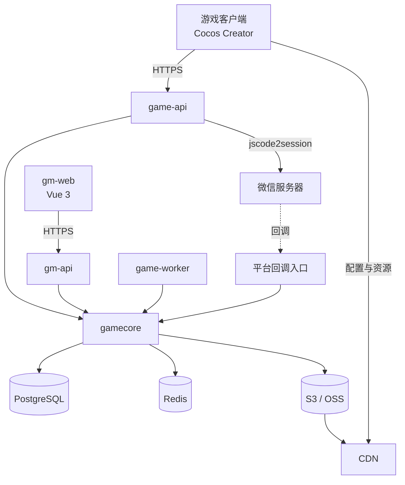
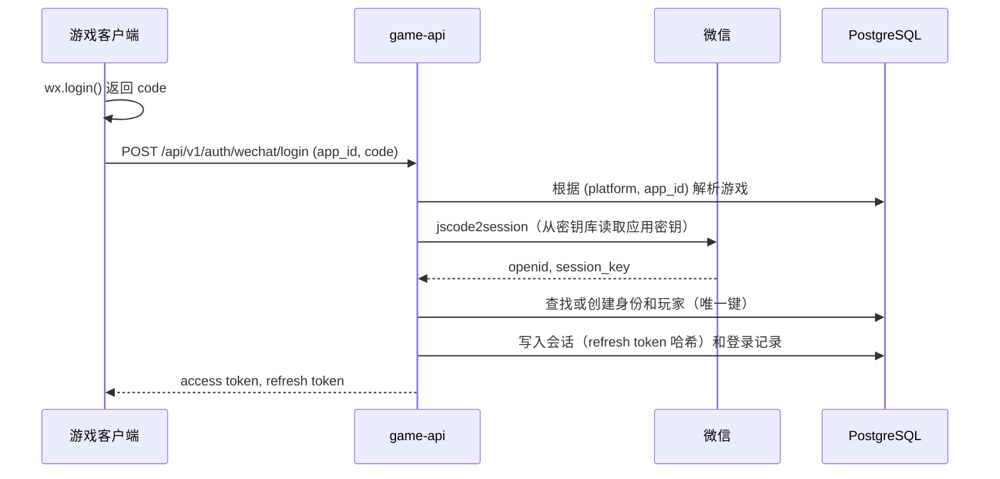
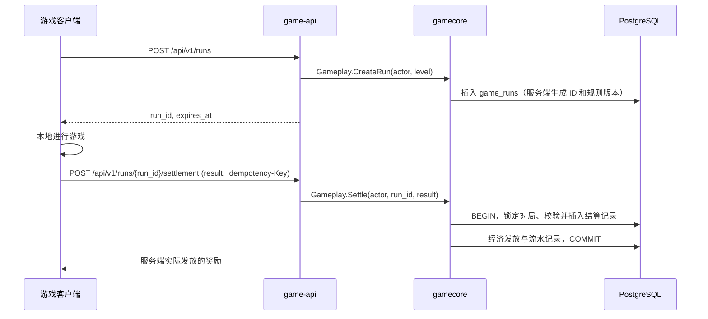

# 系统架构

- **状态：** 评审草案（2026-11-23）
- **细化：** [ADR-0001](../adr/ADR-0001-modular-monolith.md)、[ADR-0005](../adr/ADR-0005-api-service-boundaries.md)、[ADR-0008](../adr/ADR-0008-internal-api-and-worker.md)
- **来源：** [技术设计](../game-platform-technical-design.md)第 1、2、15 节

若本文档与 ADR 冲突，以 ADR 为准。标记为**（提案）**的内容未在设计文档或 ADR 中说明，尚待确认。

## 1. 平台定位

一个后端服务多款小游戏，但不实现任何具体游戏规则。平台提供各游戏共用的能力：账号、资料与存档、配置、对局结算、经济系统、广告奖励、邮件、公告、活动、排行榜、GM 控制台、运营数据、审计和后台任务。

V1 面向微信小游戏。后续通过平台适配器接入其他平台（抖音、支付宝、原生 Android/iOS）。

## 2. 组件视图



| 组件 | 类型 | 职责 | V1 状态 |
|---|---|---|---|
| `game-api` | Go + Gin 进程 | 面向玩家的 HTTP API | 部署 |
| `gm-api` | Go + Gin 进程 | 面向运营人员的 HTTP API | 部署 |
| `game-worker` | Go 进程，无入站流量 | Outbox 与后台任务 | 部署 |
| `internal-api` | Go + Gin 进程 | 服务间 HTTP API | 预留，不部署 |
| 平台回调入口 | 路由组 | 接收微信和广告平台的入站调用 | 如需实现，由 `game-api` 独立路由组承载。详见[服务边界](service-boundaries.md#5-第三方回调) |
| `gamecore` | Go 包 | 业务规则的唯一实现 | 进程内库 |
| `gm-web` | Vue 3 静态应用 | 运营控制台 | 部署 |
| `game-client` | Cocos Creator 应用 | 游戏客户端 | 按游戏提供 |
| PostgreSQL | 数据库 | 权威业务数据和任务队列 | 优先使用托管服务 |
| Redis | 缓存 | 缓存、限流、排行榜读取加速 | 优先使用托管服务 |
| S3 / OSS + CDN | 对象存储 | 配置负载、资源和存档备份 | 云服务 |

## 3. Go 模块内的分层

```text
services/<entry>/cmd        进程装配：配置、日志、DB 连接池、路由、关闭流程
        │
internal/transport/http/<entry>   Handler、DTO、路由（每个入口使用独立包树）
internal/security/<plane>         认证与 Actor 构造
        │
internal/gamecore/application    用例、事务边界、授权检查
internal/gamecore/domain         实体、值对象、不变量
internal/gamecore/repository     持久化接口及 PostgreSQL 实现
        │
internal/infrastructure          PostgreSQL、Redis、存储、可观测性
internal/platform/<provider>     微信及未来的平台适配器
```

依赖只能向下。`gamecore` 不得导入 Gin 或任何传输层包；各入口包不得互相导入。

## 4. 关键请求流程

### 4.1 玩家登录



`session_key` 始终保留在服务端。客户端绝不发送 `game_id`。

### 4.2 对局结算



结算记录、余额更新和流水要么一起提交，要么全部回滚。

### 4.3 GM 钱包调账

1. `gm-web` 调用 `POST /gm/v1/games/{game_id}/players/{player_id}/wallet-adjustments`，传入带符号的金额、原因和 `Idempotency-Key`。
2. `gm-api` 验证管理员身份，检查其在该游戏是否拥有 `economy.grant` 或 `economy.deduct` 权限，并构造管理员 `Actor`。
3. `gamecore` 在同一事务中锁定钱包、检查幂等性、更新余额、写入流水和审计记录。

### 4.4 群发邮件

1. 运营人员创建邮件草稿，然后调用 `.../mails/{mail_id}/send`。
2. `gm-api` 在一个事务中写入 `operation.reward_jobs` 和 `system.background_jobs`，并返回 `202` 及任务引用。
3. `game-worker` 领取任务，分页处理目标玩家，并幂等地插入 `operation.player_mail` 记录。
4. 玩家通过 `game-api` 领取附件；奖励由经济服务发放。

## 5. 技术栈

| 层 | 选型 |
|---|---|
| 语言 | 所有 API 和 Worker 均使用 Go |
| HTTP | Gin |
| 配置 | Viper 或 koanf |
| 日志 | `slog`、JSON |
| 数据库 | PostgreSQL 16+ |
| 数据访问 | 资产、流水、幂等、排行榜和统计使用显式 SQL（sqlc 或手写）；管理类 CRUD 可使用 GORM |
| 缓存 | 通过 go-redis 使用 Redis |
| 迁移 | golang-migrate 或 Atlas |
| API 契约 | OpenAPI 3.1 |
| GM 前端 | Vue 3、TypeScript、Element Plus |
| 客户端 | Cocos Creator、TypeScript |
| 对象存储 | S3 / OSS，通过 CDN 分发 |
| 部署 | 首先使用 Docker Compose，并保持向 Kubernetes 迁移的可移植性 |
| 监控 | Prometheus、Grafana |
| 链路追踪 | OpenTelemetry |

仍有两项技术选择待定：Viper 或 koanf，以及 golang-migrate 或 Atlas。两者将在 T01–T04 中决定，不影响架构。

## 6. V1 不包含的内容

支付、实时战斗服务器、Kafka 或 RocketMQ、Kubernetes、服务注册中心或微服务网关，以及已部署的 `internal-api`。

## 7. 相关文档

| 主题 | 文档 |
|---|---|
| 入口边界和包规则 | [服务边界](service-boundaries.md) |
| 游戏间隔离 | [游戏隔离](game-isolation.md) |
| 认证与授权 | [认证与授权](authentication-and-authorization.md) |
| 服务端权威数据 | [数据权威模型](data-authority-model.md) |
| 钱包、道具和流水 | [经济系统设计](economy-design.md) |
| 任务与 Outbox | [异步任务设计](async-job-design.md) |
| 部署 | [部署架构](deployment-architecture.md) |
