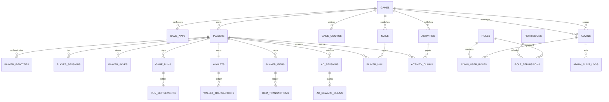

# PostgreSQL ERD

The ERD is a domain-level view. The executable source of truth is [schema.sql](schema.sql). Most game-owned tables include `game_id`; composite foreign keys prevent cross-game references.

## Relationship and key rules

- `games.id` is the game namespace. `players` has a composite unique key `(game_id, id)`.
- External identity uniqueness is `(game_id, platform, app_id, openid)`; `unionid` is not a cross-game account key.
- All player-owned references include `game_id` in their foreign key.
- Wallet balance is a cached current balance; `wallet_transactions` is the immutable accounting ledger.
- Item quantity is a current projection; `item_transactions` records changes.
- A game run can be settled at most once; a settlement references a unique run.
- An ad session can create at most one reward claim per reward type/session policy.
- Admin authorization is role + permission + game scope. Audit rows are append-only by privilege policy.
- Config payloads may live in object storage; PostgreSQL stores version, checksum, object key, validation and release metadata.
