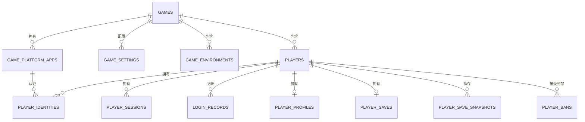
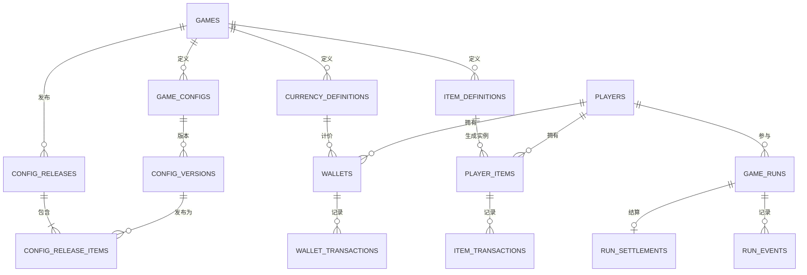
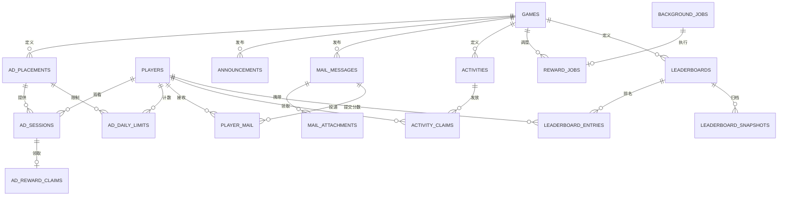

# PostgreSQL 实体关系图（ERD）

基线 v2.0（2026-11-23）。本文从领域层面展示[技术设计](../game-platform-technical-design.md)第 5.2 节定义的 13 个 Schema、57 张表。可执行的事实来源是[数据库结构文件](schema.sql)。每张游戏归属表均包含 `game_id`；包含 `game_id` 的复合外键可阻止跨游戏引用。

## 数据表目录

| Schema | 数据表 |
|---|---|
| `platform` | `games`、`game_platform_apps`、`game_settings`、`game_environments` |
| `auth` | `player_identities`、`player_sessions`、`login_records` |
| `player` | `players`、`player_profiles`、`player_saves`、`player_save_snapshots`、`player_bans` |
| `game` | `game_configs`、`config_versions`、`config_releases`、`config_release_items` |
| `gameplay` | `game_runs`、`run_settlements`、`run_events` |
| `economy` | `currency_definitions`、`wallets`、`wallet_transactions`、`item_definitions`、`player_items`、`item_transactions` |
| `ads` | `ad_placements`、`ad_sessions`、`ad_reward_claims`、`ad_daily_limits` |
| `operation` | `announcements`、`mail_messages`、`mail_attachments`、`player_mail`、`activities`、`activity_claims`、`reward_jobs` |
| `ranking` | `leaderboards`、`leaderboard_entries`、`leaderboard_snapshots` |
| `admin` | `admin_users`、`roles`、`permissions`、`admin_user_roles`、`role_permissions`、`admin_sessions`、`admin_mfa` |
| `audit` | `admin_audit_logs`、`service_audit_logs` |
| `analytics` | `game_events`、`daily_player_stats`、`daily_game_stats` |
| `system` | `idempotency_keys`、`outbox_events`、`background_jobs`、`service_identities`、`service_credentials`、`service_game_grants` |

## 平台、身份与玩家

## 配置、玩法与经济系统

## 广告、运营与排行榜

## 管理、审计、分析与系统

```mermaid
erDiagram
  ADMIN_USERS ||--o{ ADMIN_USER_ROLES : 分配
  ROLES ||--o{ ADMIN_USER_ROLES : 分配
  GAMES ||--o{ ADMIN_USER_ROLES : 限定范围
  ROLES ||--o{ ROLE_PERMISSIONS : 授权
  PERMISSIONS ||--o{ ROLE_PERMISSIONS : 纳入
  ADMIN_USERS ||--o{ ADMIN_SESSIONS : 拥有
  ADMIN_USERS ||--o| ADMIN_MFA : 注册
  ADMIN_USERS ||--o{ ADMIN_AUDIT_LOGS : 操作
  SERVICE_IDENTITIES ||--o{ SERVICE_CREDENTIALS : 持有
  SERVICE_IDENTITIES ||--o{ SERVICE_GAME_GRANTS : 获授权
  GAMES ||--o{ SERVICE_GAME_GRANTS : 限定范围
  SERVICE_IDENTITIES ||--o{ SERVICE_AUDIT_LOGS : 操作
  GAMES ||--o{ GAME_EVENTS : 收集
  GAMES ||--o{ DAILY_GAME_STATS : 汇总
  PLAYERS ||--o{ DAILY_PLAYER_STATS : 汇总
  GAMES ||--o{ BACKGROUND_JOBS : 限定范围
  GAMES ||--o{ OUTBOX_EVENTS : 发出
```

`system.idempotency_keys` 没有外键；其复合键为 `(scope, idempotency_key)`。

## 关系与键规则

- `platform.games.id` 是游戏命名空间。`player.players` 使用复合唯一键 `(game_id, id)`，所有玩家归属表都引用此键。
- 外部身份唯一键为 `(game_id, platform, app_id, openid)`。会存储 `unionid`，但它绝不作为跨游戏账号关联键。
- `platform.game_platform_apps` 中 `(platform, app_id)` 唯一，因此登录时由服务端根据平台应用解析 `game_id`，而不信任客户端传入的 `game_id`。
- 钱包余额是投影；`economy.wallet_transactions` 是不可变流水。`player_items` 与 `item_transactions` 也采用相同设计。两个流水表和两个审计表除了受权限限制外，还通过 `system.reject_mutation()` 触发器拒绝 `UPDATE`/`DELETE`。
- 每场游戏对局最多结算一次：`gameplay.run_settlements` 上设置 `UNIQUE (game_id, run_id)`。
- 每个广告会话最多领取一次：`ads.ad_reward_claims` 上设置 `UNIQUE (game_id, session_id)`。
- 配置发布不可变。回滚时插入新发布记录，其发布项引用旧版本。某配置当前启用的版本，是具有最高 `release_no` 的发布记录中对应的发布项。
- 管理员授权按角色 + 权限 + 范围判断。平台级范围由 `scope_type = 'platform'` 明确表示，绝不隐式使用 `NULL`。
- `operation.reward_jobs` 是批量发放的业务记录；执行状态保存在 `system.background_jobs`，并由 `game-worker` 驱动。
- PostgreSQL 是排行榜的权威数据源；Redis 仅用于加速读取。

## 与设计文档的差异

设计文档第 5.2 节列出逻辑键字段。DDL 保留所有表名，并作出以下调整。每项调整都是为满足约束而进行的细化，不改变设计意图。

| 表 | 设计文档 | schema.sql | 原因 |
|---|---|---|---|
| `platform.game_settings` | `key`、`value` | `setting_key`、`setting_value` | 避免使用类似关键字的列名 |
| `player.player_profiles` | `avatar` | `avatar_url` | 该列存储 URL |
| `game.config_releases` | 发布记录上的 `version_id` | 移除；版本仅通过 `config_release_items` 引用 | 两处同时保存会导致发布头与发布项不一致 |
| `game.config_release_items` | `release_id, config_id, version_id` | 增加 `game_id` | 支持复合外键 |
| `economy.wallet_transactions` | `UNIQUE (game_id, source_type, source_id, transaction_type)` | `UNIQUE (game_id, player_id, currency_code, source_type, source_id, transaction_type)`；`amount` 为正数，另设 `direction` | 较短的唯一键会拒绝一次结算发放多种货币，以及一个批处理任务使用同一 `source_id` 向多名玩家付款 |
| `economy.item_transactions` | 同上 | `UNIQUE (game_id, player_id, item_id, source_type, source_id, transaction_type)` | 原因相同 |
| `economy.wallets` | “除非货币允许，否则余额不能为负” | 所有货币均设置 `CHECK (balance >= 0)` | 由数据库约束提供最终防护；需允许负余额的货币须修订 ADR 并执行迁移 |
| `ads.ad_daily_limits` | `date`、`count` | `limit_date`、`claim_count` | 避免使用类似关键字的列名 |
| `operation.announcements` | `game_id` | 增加 `scope`（`global` / `game`）；仅 `global` 时 `game_id` 为 `NULL` | 设计同时要求全局公告和游戏公告 |
| `operation.mail_attachments` | `id, mail_id, …` | 增加 `game_id` | 支持复合外键 |
| `ranking.leaderboard_entries` | `game_id, board_id, player_id` | 主键增加 `period_key` | 日榜、周榜和赛季榜需在各周期内分别记录玩家条目 |
| `admin.admin_user_roles` | `admin_id, role_id, game_id` | 增加 `scope_type` | 显式表示平台范围，不用 `NULL` 表示“所有游戏” |
| `audit.admin_audit_logs` | `target` | `target_type`、`target_id` | 便于查询目标 |
| `system.idempotency_keys` | `key`、`response` | `idempotency_key`、`response_status`、`response_body`、`state` | 支持重放已保存响应和检测进行中的请求 |
| `system.service_credentials` | `credential_hash` | `credential_hash`（mTLS 证书指纹），并增加 HMAC 使用的 `access_key_id` 和 `secret_ref` | HMAC 签名无法通过密钥的单向哈希验证；密钥保存在密钥管理器中 |

## 状态

DDL 目前是设计基线，尚未在 PostgreSQL 中执行。授权、RLS 和迁移顺序仍需在 T03 和 T21 中交付。
