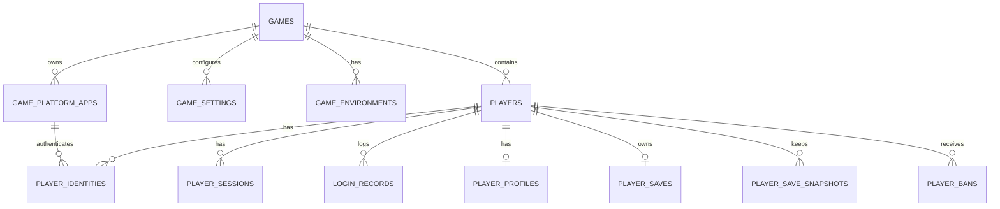
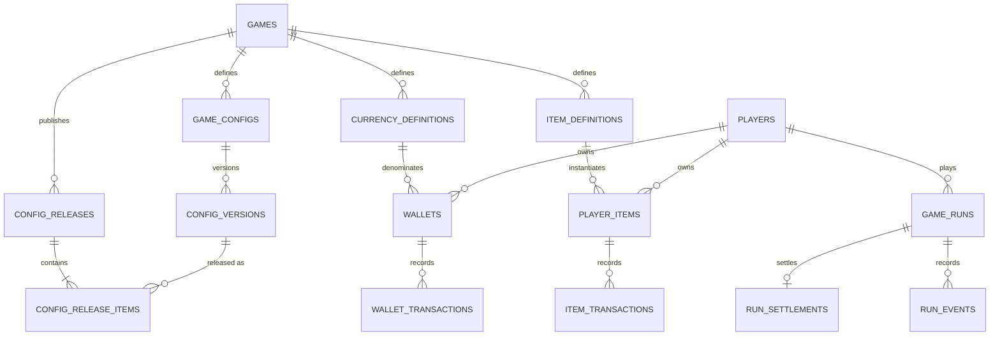
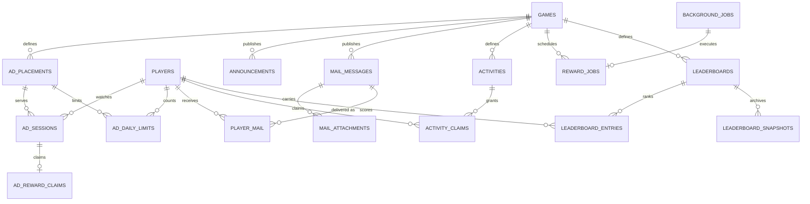

# PostgreSQL ERD

Baseline v2.0 (2026-11-23). This is a domain-level view of the 57 tables in 13 schemas defined by section 5.2 of the [technical design](../game-platform-technical-design.md). The executable source of truth is [schema.sql](schema.sql). Every game-owned table carries `game_id`, and composite foreign keys that include `game_id` prevent cross-game references.

## Table inventory

| Schema | Tables |
|---|---|
| `platform` | `games`, `game_platform_apps`, `game_settings`, `game_environments` |
| `auth` | `player_identities`, `player_sessions`, `login_records` |
| `player` | `players`, `player_profiles`, `player_saves`, `player_save_snapshots`, `player_bans` |
| `game` | `game_configs`, `config_versions`, `config_releases`, `config_release_items` |
| `gameplay` | `game_runs`, `run_settlements`, `run_events` |
| `economy` | `currency_definitions`, `wallets`, `wallet_transactions`, `item_definitions`, `player_items`, `item_transactions` |
| `ads` | `ad_placements`, `ad_sessions`, `ad_reward_claims`, `ad_daily_limits` |
| `operation` | `announcements`, `mail_messages`, `mail_attachments`, `player_mail`, `activities`, `activity_claims`, `reward_jobs` |
| `ranking` | `leaderboards`, `leaderboard_entries`, `leaderboard_snapshots` |
| `admin` | `admin_users`, `roles`, `permissions`, `admin_user_roles`, `role_permissions`, `admin_sessions`, `admin_mfa` |
| `audit` | `admin_audit_logs`, `service_audit_logs` |
| `analytics` | `game_events`, `daily_player_stats`, `daily_game_stats` |
| `system` | `idempotency_keys`, `outbox_events`, `background_jobs`, `service_identities`, `service_credentials`, `service_game_grants` |

## Platform, identity and player

## Configuration, gameplay and economy

## Ads, operations and ranking

## Admin, audit, analytics and system

```mermaid
erDiagram
  ADMIN_USERS ||--o{ ADMIN_USER_ROLES : assigned
  ROLES ||--o{ ADMIN_USER_ROLES : assigned
  GAMES ||--o{ ADMIN_USER_ROLES : scopes
  ROLES ||--o{ ROLE_PERMISSIONS : grants
  PERMISSIONS ||--o{ ROLE_PERMISSIONS : included
  ADMIN_USERS ||--o{ ADMIN_SESSIONS : has
  ADMIN_USERS ||--o| ADMIN_MFA : enrolls
  ADMIN_USERS ||--o{ ADMIN_AUDIT_LOGS : operates
  SERVICE_IDENTITIES ||--o{ SERVICE_CREDENTIALS : holds
  SERVICE_IDENTITIES ||--o{ SERVICE_GAME_GRANTS : authorized
  GAMES ||--o{ SERVICE_GAME_GRANTS : scopes
  SERVICE_IDENTITIES ||--o{ SERVICE_AUDIT_LOGS : operates
  GAMES ||--o{ GAME_EVENTS : collects
  GAMES ||--o{ DAILY_GAME_STATS : aggregates
  PLAYERS ||--o{ DAILY_PLAYER_STATS : aggregates
  GAMES ||--o{ BACKGROUND_JOBS : scopes
  GAMES ||--o{ OUTBOX_EVENTS : emits
```

`system.idempotency_keys` has no foreign keys; it is keyed by `(scope, idempotency_key)`.

## Relationship and key rules

- `platform.games.id` is the game namespace. `player.players` has the composite unique key `(game_id, id)` that every player-owned table references.
- External identity uniqueness is `(game_id, platform, app_id, openid)`. `unionid` is stored but is never a cross-game account key.
- `(platform, app_id)` is unique in `platform.game_platform_apps`, so the server resolves `game_id` from the platform app at login instead of trusting a client-supplied `game_id`.
- Wallet balance is a projection; `economy.wallet_transactions` is the immutable ledger. The same holds for `player_items` and `item_transactions`. Both ledgers and both audit tables reject `UPDATE`/`DELETE` through the `system.reject_mutation()` trigger in addition to privileges.
- A game run can be settled at most once: `UNIQUE (game_id, run_id)` on `gameplay.run_settlements`.
- An ad session can be claimed at most once: `UNIQUE (game_id, session_id)` on `ads.ad_reward_claims`.
- A config release is immutable. Rollback inserts a new release whose items reference older versions. The active version of a config is the item of the release with the highest `release_no`.
- Admin authorization is role + permission + scope. Platform-wide scope is an explicit `scope_type = 'platform'` row, never an implicit `NULL`.
- `operation.reward_jobs` is the business record of a batch grant; execution state lives in `system.background_jobs` and is driven by `game-worker`.
- PostgreSQL is authoritative for leaderboards; Redis only accelerates reads.

## Deviations from the design document

Section 5.2 of the design document lists logical key fields. The DDL keeps every table name and makes the following adjustments. Each one is a refinement needed for the constraints to hold, not a change of intent.

| Table | Design document | schema.sql | Reason |
|---|---|---|---|
| `platform.game_settings` | `key`, `value` | `setting_key`, `setting_value` | Avoid keyword-like column names |
| `player.player_profiles` | `avatar` | `avatar_url` | The column stores a URL |
| `game.config_releases` | `version_id` on the release | Removed; versions are referenced only through `config_release_items` | Having it in both places allows the header and the items to disagree |
| `game.config_release_items` | `release_id, config_id, version_id` | Adds `game_id` | Composite foreign keys |
| `economy.wallet_transactions` | `UNIQUE (game_id, source_type, source_id, transaction_type)` | `UNIQUE (game_id, player_id, currency_code, source_type, source_id, transaction_type)`; `amount` is positive with a separate `direction` | The shorter key rejects a settlement that grants two currencies, and a batch job that pays many players from one `source_id` |
| `economy.item_transactions` | Same as above | `UNIQUE (game_id, player_id, item_id, source_type, source_id, transaction_type)` | Same reason |
| `economy.wallets` | "No negative balance unless the currency allows it" | `CHECK (balance >= 0)` for every currency | Database constraint as the final defence; a currency that must go negative needs an ADR amendment and a migration |
| `ads.ad_daily_limits` | `date`, `count` | `limit_date`, `claim_count` | Avoid keyword-like column names |
| `operation.announcements` | `game_id` | Adds `scope` (`global` / `game`); `game_id` is `NULL` only for `global` | The design requires both global and game announcements |
| `operation.mail_attachments` | `id, mail_id, …` | Adds `game_id` | Composite foreign keys |
| `ranking.leaderboard_entries` | `game_id, board_id, player_id` | Adds `period_key` to the primary key | Daily/weekly/season boards need one entry per period |
| `admin.admin_user_roles` | `admin_id, role_id, game_id` | Adds `scope_type` | Explicit platform scope instead of `NULL` meaning "all games" |
| `audit.admin_audit_logs` | `target` | `target_type`, `target_id` | Queryable target |
| `system.idempotency_keys` | `key`, `response` | `idempotency_key`, `response_status`, `response_body`, `state` | Replay of the stored response and in-flight detection |
| `system.service_credentials` | `credential_hash` | `credential_hash` (mTLS certificate fingerprint) plus `access_key_id` and `secret_ref` for HMAC | HMAC signatures cannot be verified from a one-way hash of the secret; the secret stays in the secret manager |

## Status

The DDL is a design baseline. It has not yet been executed against PostgreSQL, and grants, RLS and migration ordering are still to be delivered in tasks T03 and T21.
