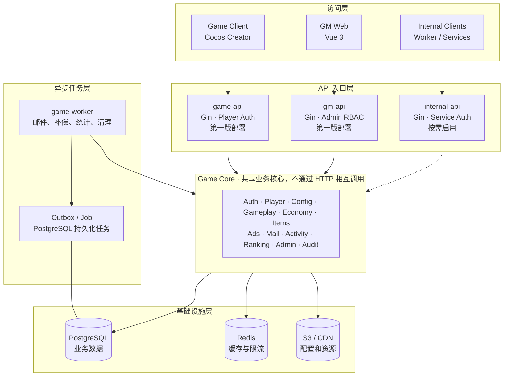
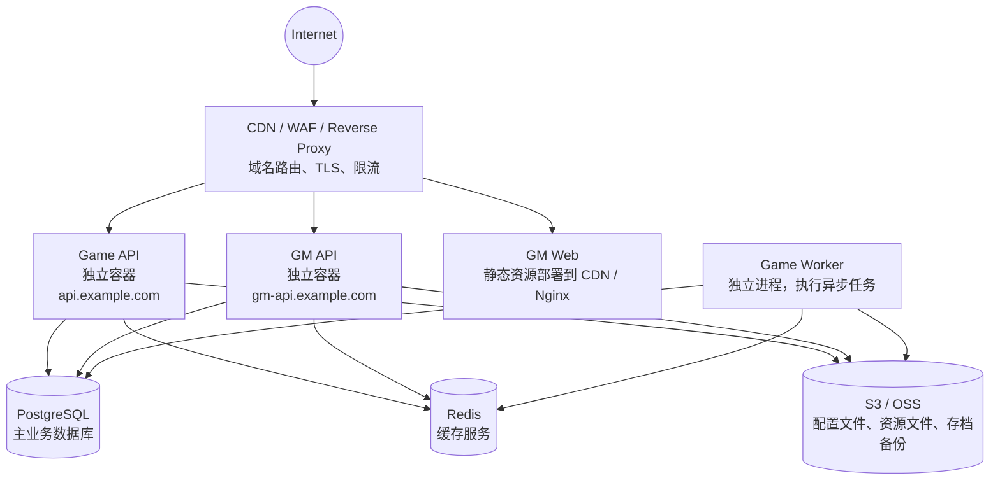

# Game Platform 技术设计与实施方案

> 文档状态：架构基线（Baseline）  
> 版本：2.0（替代 1.0）  
> 日期：2026-11-23  
> 架构基线：微信小游戏优先 · 模块化单体  
> 技术栈：Go + Gin + PostgreSQL + Redis + Vue 3 + Cocos Creator  
> 配套规范：[`adr/`](adr/)、[`architecture/decisions.md`](architecture/decisions.md)、[`database/schema.sql`](database/schema.sql)、[`database/erd.md`](database/erd.md)、[`../api/openapi/`](../api/openapi/)、[`implementation/roadmap.md`](implementation/roadmap.md)

本版将之前的架构决策统一整理，重点修正三个地方：

1. 玩家 API、GM API 从第一版开始独立部署，但共享同一套 Game Core，不拆成微服务。
2. 预留 Internal API 和 Worker 体系，但不为了架构完整而提前部署第三套 HTTP 服务。
3. 从第一版就建设完整 GM 平台，包括管理员、RBAC、玩家管理、经济管理、配置中心、邮件、活动、审计和基础运营数据。

最终采用：**Go + Gin + PostgreSQL + Redis + Vue 3 + Cocos Creator**。

---

## 一、项目定位与架构决策

### 1.1 项目目标

建设一个可同时承载多款小游戏的统一游戏后端平台。

第一阶段聚焦微信小游戏，后续预留接入其他平台的能力，例如抖音小游戏、支付宝小游戏、原生 Android/iOS 等。

平台不负责实现每款游戏的具体玩法，而是提供通用的游戏后端能力：

- 游戏账号与身份认证。
- 玩家资料和存档。
- 游戏配置和版本管理。
- 局次记录与结算。
- 金币、钻石、道具等经济系统。
- 广告奖励。
- 邮件、公告、活动。
- 排行榜。
- GM 管理平台。
- 游戏运营数据和审计。
- 后台异步任务。

### 1.2 已确定的架构决策

| 决策项 | 最终方案 |
|---|---|
| 玩家账号 | 每款游戏独立玩家账号 |
| 游戏数据隔离 | 以 `game_id` 为核心 |
| 首发平台 | 微信小游戏 |
| 多平台支持 | 预留 Platform Adapter |
| 战斗执行 | 客户端运行 |
| 关键数据 | 服务端权威 |
| 玩家 API | 独立 `game-api` |
| GM API | 独立 `gm-api` |
| 内部 API | 预留 `internal-api` |
| 业务核心 | 共享 `gamecore` |
| 后台任务 | 独立 `game-worker` |
| API 框架 | Go + Gin |
| GM 前端 | Vue 3 + TypeScript + Element Plus |
| 游戏客户端 | Cocos Creator + TypeScript |
| 主数据库 | PostgreSQL |
| 缓存 | Redis |
| 文件存储 | S3/OSS + CDN |
| 部署方式 | Docker Compose 起步，支持后续迁移 Kubernetes |
| 架构模式 | 模块化单体 + 多入口独立部署 |

### 1.3 最重要的设计原则

**第一，玩家账号与游戏隔离。** 同一个微信用户进入两个不同小游戏，默认创建两个不同的 `player_id`。

**第二，客户端不能直接决定关键资产。** 金币、钻石、道具、永久解锁、奖励领取结果都由服务端决定。

**第三，GM 和玩家使用不同的安全体系。** 不能因为两者最终调用相同的业务 Service，就共用认证、权限和 Token。

**第四，API 入口与业务核心解耦。** 未来可以增加 Internal API、Worker、第三方平台接入，但不需要复制业务逻辑。

**第五，不提前建设分布式基础设施。** 第一版不需要 Kafka、RocketMQ、服务注册中心、微服务网关和复杂分布式事务。

---

## 二、整体系统架构

### 2.1 逻辑架构



虚线表示预留、按需启用的路径。

### 2.2 四类入口的边界

这是整个平台非常重要的架构边界。

| 组件 | 面向对象 | 主要职责 | 是否第一版部署 |
|---|---|---|---|
| `game-api` | 玩家客户端 | 登录、存档、结算、资产、活动 | 是 |
| `gm-api` | GM Web | 管理、运营、审核、审计 | 是 |
| `internal-api` | 内部服务 | 机器间受控调用 | 否，预留 |
| `game-worker` | 后台任务 | 异步任务执行 | 按任务需求启用 |

**为什么要拆成两个 API 服务？**

虽然玩家 API 和 GM API 共用 Game Core，但它们有完全不同的安全要求。例如：

- 玩家只能读取和修改自己的数据。
- GM 可以查看指定游戏的玩家数据。
- GM 可能拥有封禁玩家、恢复存档、人工调账等高权限操作。
- Worker 需要执行系统任务，但不应该获得 GM 权限。
- 内部服务需要机器身份认证，而不是玩家 Token。

因此，不能只依赖 URL 前缀区分权限。

建议分别配置：

```text
api.example.com       -> game-api
gm-api.example.com    -> gm-api
gm.example.com        -> gm-web
internal.example.com  -> internal-api（仅内网，按需部署）
cdn.example.com       -> CDN
```

### 2.3 Game Core 如何共享？

建议采用一个 Go Module。

```text
game-api ───────┐
                ├──> Game Core ──> Repository ──> PostgreSQL
gm-api ─────────┤                    │
                │                    └────────────> Redis
game-worker ────┘
```

关键原则：

- Handler 不共享。
- Router 不共享。
- 认证中间件不共享。
- DTO 不强行共用。
- Domain、Application Service、Repository 可以共享。
- 所有业务操作显式传递调用者身份和授权上下文。

例如：

```go
type Actor struct {
    Type    string // player / admin / service / system
    ID      string
    GameID  string
    Roles   []string
    Service string
}

type EconomyService interface {
    Grant(ctx context.Context, actor Actor, req GrantRequest) error
    Spend(ctx context.Context, actor Actor, req SpendRequest) error
    GetWallet(ctx context.Context, actor Actor, playerID string) (*Wallet, error)
}
```

这里的 `Actor` 是业务调用者上下文，不应该直接信任客户端传入的字段，而应由对应入口完成认证和授权后构造。

---

## 三、技术栈与组件选型

| 层级 | 技术 | 用途 |
|---|---|---|
| 后端语言 | Go | 所有 API 和 Worker |
| HTTP 框架 | Gin | 路由、中间件、请求处理 |
| 配置 | Viper 或 koanf | 配置加载 |
| 日志 | slog | JSON 结构化日志 |
| 数据库 | PostgreSQL | 权威业务数据 |
| ORM | GORM 或 sqlc | 数据访问 |
| Redis | go-redis | 缓存、限流、排行榜 |
| 数据库迁移 | golang-migrate 或 Atlas | Schema 版本管理 |
| API 契约 | OpenAPI 3.1 | API 定义 |
| GM 前端 | Vue 3 | 管理后台 |
| 前端语言 | TypeScript | 类型安全 |
| UI | Element Plus | 管理界面 |
| 客户端 | Cocos Creator | 小游戏客户端 |
| 对象存储 | S3 / OSS | 配置包、资源 |
| CDN | CloudFront / BytePlus CDN 等 | 资源分发 |
| 部署 | Docker Compose | 第一阶段 |
| 监控 | Prometheus + Grafana | 指标监控 |
| 追踪 | OpenTelemetry | 请求链路追踪 |

### 3.1 GORM 还是 sqlc？

建议：**核心资产和事务逻辑优先使用明确的 SQL，普通 CRUD 可以使用 GORM。**

原因：

- 钱包扣款、发奖、流水插入涉及事务和并发控制。
- 这些逻辑需要明确 SQL、行锁和唯一约束。
- GORM 可以提升管理类 CRUD 开发效率，但不应该掩盖关键 SQL 的执行语义。

| 业务 | 实现方式 |
|---|---|
| 管理员 CRUD | GORM |
| 游戏配置 CRUD | GORM |
| 玩家资料 CRUD | GORM 或 sqlc |
| 钱包发放/扣款 | 显式 SQL |
| 资产流水 | 显式 SQL |
| 幂等处理 | 显式 SQL |
| 排行榜查询 | 显式 SQL |
| 复杂统计 | 显式 SQL |

数据库访问不要在 Handler 中直接编写 SQL。

---

## 四、核心模块设计

### 4.1 平台管理模块

负责管理所有接入平台的游戏。

功能：

- 创建游戏。
- 启用/禁用游戏。
- 配置游戏基础信息。
- 配置微信 AppID。
- 配置游戏环境。
- 配置游戏密钥。
- 配置 CDN 和资源地址。
- 配置游戏运行参数。

建议支持：

```text
game_id
  ├── game_name
  ├── status
  ├── platform_apps
  │   ├── wechat_app_id
  │   └── future_platform_app_id
  ├── environments
  │   ├── development
  │   ├── staging
  │   └── production
  └── game_settings
```

建议 `game_id` 作为平台级隔离主键，不要直接使用微信 AppID 代替。

### 4.2 玩家账号与认证模块

账号规则：

```text
Game A + WeChat OpenID A -> Player A
Game B + WeChat OpenID A -> Player B
```

不同游戏不自动共享玩家账号。

身份映射唯一约束：

```sql
UNIQUE (game_id, platform, app_id, openid)
```

微信登录流程：

1. 客户端调用 `wx.login()`，获得临时 code。
2. 客户端将 code 发送给 game-api。
3. 服务端调用微信 `jscode2session`。
4. 服务端获得 OpenID，并根据当前游戏映射玩家身份。
5. 不存在玩家时创建 `player_id`。
6. 签发平台自己的 Access Token 和 Refresh Token。
7. 客户端使用平台 Token 访问后续 API。

安全要求：

- AppSecret 只能保存在服务端 Secret 中。
- 不将微信 `session_key` 返回客户端。
- Refresh Token 存储哈希，不存明文。
- Refresh Token 轮换。
- 支持主动注销、撤销和封禁。
- 登录接口限流。
- 微信登录失败需要记录可排查的错误信息。

Token 建议：

| Token | 初始建议 |
|---|---|
| Access Token | 1 小时 |
| Refresh Token | 30 天 |
| GM Access Token | 15–30 分钟 |
| GM Refresh Token | 由安全策略决定，支持撤销 |
| Service Credential | 独立 AK/SK 或 mTLS |

具体有效期可以在安全评审后调整。

### 4.3 玩家资料与存档模块

分开管理：

- 玩家基础资料。
- 游戏永久进度。
- 玩家存档。
- 存档历史版本。

不要把所有游戏数据放进一个 JSONB。

推荐：

```text
players
  ├── player_profiles
  ├── player_saves
  └── player_save_snapshots
```

存档字段：

```sql
CREATE TABLE player.player_saves (
    game_id UUID NOT NULL,
    player_id UUID NOT NULL,
    save_data JSONB NOT NULL,
    schema_version INTEGER NOT NULL,
    save_version BIGINT NOT NULL DEFAULT 1,
    updated_at TIMESTAMPTZ NOT NULL DEFAULT now(),
    PRIMARY KEY (game_id, player_id)
);
```

更新采用乐观锁：

```http
PUT /api/v1/player/save
If-Match: "12"
```

服务端只允许当前 `save_version = 12` 的请求更新，成功后递增版本。这样可以避免多端同时登录造成存档覆盖。

需要特别区分：

- 存档适合保存非关键的游戏状态。
- 金币、钻石、道具、支付权益等资产必须使用独立业务表。
- 不允许客户端通过提交存档 JSON 直接修改权威资产。

### 4.4 游戏配置模块

游戏配置需要支持完整版本管理。

配置生命周期：

```text
Draft → Validate → Publish → Active → Rollback
```

能力：

- JSON 配置编辑。
- JSON Schema 校验。
- 配置版本管理。
- 配置差异对比。
- 发布记录。
- 发布人和发布时间。
- 历史版本回滚。
- CDN 缓存刷新。
- 客户端 ETag 缓存。

配置较大时，推荐：

```text
PostgreSQL
  ├── config metadata
  ├── config version
  └── config release

S3 / OSS
  └── config files

CDN
  └── static delivery
```

配置版本不可直接覆盖。发布一个新版本，回滚也是发布旧版本内容的新 Release。

### 4.5 Gameplay 局次与结算模块

由于采用：

- 客户端执行局内战斗。
- 服务端权威管理关键数据。

因此需要采用**客户端战斗、服务端结算**的模式。

局次流程：

```text
Client
  │  POST /runs
  ▼
Game API
  │  创建 game_run
  ▼
Client Battle
  │  POST /runs/{id}/settlement
  ▼
Server Validation
  │  校验规则、消耗、奖励上限、幂等
  ▼
Economy Service
  │  资产变更 + 流水 + 结算记录
  ▼
PostgreSQL
```

必须注意：**服务端无法仅凭客户端上报的 score、is_win、reward 证明战斗真的发生。**

建议：

- 服务端生成局次 ID。
- 服务端记录关卡、难度、规则版本。
- 服务端限制最大奖励。
- 服务端验证消耗和资源来源。
- 结算必须幂等。
- 相同局次不能重复结算。
- 重要玩法考虑服务端重放验证。
- 对异常成绩、短时间重复通关进行风控。

对于第一款小游戏，可以先实现轻量校验，不要一开始就建设完整战斗服务器。

### 4.6 Economy 经济系统

这是整个游戏平台最需要严格设计的模块之一。

管理对象：

- Gold。
- Diamond。
- Energy。
- 其他游戏货币。
- 道具库存。

核心模型：

```text
wallets
  └── wallet_transactions

player_items
  └── item_transactions
```

钱包余额不是由客户端决定，而是由服务端事务更新。

发放金币事务：

```sql
BEGIN;

SELECT balance
FROM economy.wallets
WHERE game_id = $1
  AND player_id = $2
  AND currency_code = $3
FOR UPDATE;

-- 检查幂等键
-- 校验发放规则和额度
-- 更新钱包余额
-- 写入交易流水

COMMIT;
```

核心约束：

- 每次变更必须有流水。
- 不允许直接修改余额。
- 交易必须幂等。
- 同一来源不能重复发奖。
- 扣款不能产生负余额，除非货币明确允许。
- 金额使用整数最小单位，不使用浮点数。
- GM 人工调账必须填写原因。
- GM 调账应写入独立审计记录。

### 4.7 广告奖励模块

微信小游戏广告奖励需要单独设计。

典型流程：

```text
Client
  │  POST /ads/sessions
  ▼
Server creates ad_session
  │
  ▼
Client plays rewarded ad
  │  POST /ads/sessions/{id}/claim
  ▼
Server validates
  │
  ▼
Economy Service grants reward
```

重要限制：微信客户端 `onClose({ isEnded: true })` 只能证明客户端观察到广告播放完成，不能直接证明服务端已经获得可信播放证明。

因此：

- 创建广告播放会话。
- 设置会话有效期。
- 校验玩家、广告位、游戏。
- 限制每日奖励次数。
- 防止重复领取。
- 记录异常设备和异常行为。
- 如果平台没有可验证的服务端回调，不能承诺彻底防止作弊。

### 4.8 运营模块

第一版支持：

| 模块 | 功能 |
|---|---|
| 邮件 | 创建邮件、群发、附件奖励、领取 |
| 公告 | 全局公告、游戏公告、有效期 |
| 活动 | 活动配置、时间范围、任务、奖励 |
| 补偿 | 面向指定玩家或玩家群体发放 |
| 排行榜 | 排行榜创建、查询、重建 |
| 推送任务 | 后台执行、状态追踪 |

群发、批量奖励和大规模邮件必须走异步任务，不能在一个 GM HTTP 请求里直接处理几十万玩家。

---

## 五、PostgreSQL 数据库设计

### 5.1 Database 与 Schema 规划

建议第一版使用一个 PostgreSQL Database：`game_platform`，按照业务领域划分 Schema。

| Schema | 职责 |
|---|---|
| `platform` | 游戏和平台配置 |
| `auth` | 玩家身份和会话 |
| `player` | 玩家资料和存档 |
| `game` | 游戏配置和发布 |
| `gameplay` | 局次和结算 |
| `economy` | 钱包、货币、道具 |
| `ads` | 广告位和奖励 |
| `operation` | 邮件、公告、活动 |
| `ranking` | 排行榜 |
| `admin` | 管理员、角色、权限 |
| `audit` | 审计 |
| `analytics` | 事件和统计 |
| `system` | 幂等、Outbox、后台任务 |

第一版不要按每款游戏创建独立 Database。采用：

```text
game_platform
  ├── game_id = Game A
  ├── game_id = Game B
  └── game_id = Game C
```

这样可以共享平台能力，同时在业务层按 `game_id` 隔离数据。

### 5.2 完整 ERD：核心表清单

下面是第一版建议建设的完整逻辑表集合。表名使用 `schema.table`。

> 本节列出的是逻辑关键字段。物理字段名、类型和完整约束以 [`database/schema.sql`](database/schema.sql) 为准；DDL 落地时相对本节的命名规范化和约束细化，记录在 [`database/erd.md`](database/erd.md) 的「与设计文档的差异」一节。

#### A. 平台管理

| 表 | 关键字段 | 用途 |
|---|---|---|
| `platform.games` | id, code, name, status | 游戏 |
| `platform.game_platform_apps` | id, game_id, platform, app_id | 平台 App 配置 |
| `platform.game_settings` | game_id, key, value | 游戏运行设置 |
| `platform.game_environments` | id, game_id, environment | 游戏环境配置 |

#### B. 玩家认证

| 表 | 关键字段 | 用途 |
|---|---|---|
| `auth.player_identities` | game_id, player_id, platform, app_id, openid, unionid | 外部身份映射 |
| `auth.player_sessions` | id, game_id, player_id, refresh_token_hash, expires_at | 玩家会话 |
| `auth.login_records` | id, game_id, player_id, platform, result | 登录记录 |

核心唯一约束：

```sql
UNIQUE (game_id, platform, app_id, openid)
```

同一玩家在一个游戏中可以有多个外部身份，但不能因为 unionid 相同就自动跨游戏合并。

#### C. 玩家

| 表 | 关键字段 | 用途 |
|---|---|---|
| `player.players` | game_id, id, status, created_at | 玩家主体 |
| `player.player_profiles` | game_id, player_id, nickname, avatar | 玩家资料 |
| `player.player_saves` | game_id, player_id, save_data, save_version | 当前存档 |
| `player.player_save_snapshots` | id, game_id, player_id, save_data, save_version | 存档历史 |
| `player.player_bans` | id, game_id, player_id, reason, expires_at | 封禁记录 |

#### D. 游戏配置

| 表 | 关键字段 | 用途 |
|---|---|---|
| `game.game_configs` | id, game_id, config_key, status | 配置定义 |
| `game.config_versions` | id, game_id, config_id, version, content | 配置版本 |
| `game.config_releases` | id, game_id, version_id, released_by | 配置发布 |
| `game.config_release_items` | release_id, config_id, version_id | 发布内容明细 |

#### E. Gameplay

| 表 | 关键字段 | 用途 |
|---|---|---|
| `gameplay.game_runs` | id, game_id, player_id, level_id, status | 局次 |
| `gameplay.run_settlements` | id, game_id, run_id, result, settled_at | 结算 |
| `gameplay.run_events` | id, game_id, run_id, event_type, payload | 重要局次事件 |

建议：

```sql
UNIQUE (game_id, run_id)
```

对结算记录建立唯一约束，保证一个局次只能成功结算一次。

#### F. Economy

| 表 | 关键字段 | 用途 |
|---|---|---|
| `economy.currency_definitions` | game_id, currency_code, name | 货币定义 |
| `economy.wallets` | game_id, player_id, currency_code, balance | 钱包 |
| `economy.wallet_transactions` | id, game_id, player_id, currency_code, amount, source_type, source_id | 钱包流水 |
| `economy.item_definitions` | game_id, item_id, name, item_type | 道具定义 |
| `economy.player_items` | game_id, player_id, item_id, quantity | 道具库存 |
| `economy.item_transactions` | id, game_id, player_id, item_id, quantity, source_type, source_id | 道具流水 |

重要约束：

```sql
UNIQUE(game_id, player_id, currency_code)
UNIQUE(game_id, source_type, source_id, transaction_type)
```

第二个约束用于限制相同业务来源重复变更资产。实际实现中还需要明确流水方向、业务动作和幂等键的组合语义。

#### G. Ads

| 表 | 关键字段 | 用途 |
|---|---|---|
| `ads.ad_placements` | id, game_id, placement_code, reward_rule | 广告位 |
| `ads.ad_sessions` | id, game_id, player_id, placement_id, expires_at | 播放会话 |
| `ads.ad_reward_claims` | id, game_id, player_id, session_id, reward_status | 奖励领取 |
| `ads.ad_daily_limits` | game_id, player_id, placement_id, date, count | 日限额 |

#### H. Operation

| 表 | 关键字段 | 用途 |
|---|---|---|
| `operation.announcements` | id, game_id, title, content, start_at, end_at | 公告 |
| `operation.mail_messages` | id, game_id, title, content, status | 邮件模板/内容 |
| `operation.mail_attachments` | id, mail_id, reward_type, reward_id, quantity | 邮件附件 |
| `operation.player_mail` | id, game_id, player_id, mail_id, claimed_at | 玩家邮件 |
| `operation.activities` | id, game_id, activity_type, config, start_at, end_at | 活动 |
| `operation.activity_claims` | id, game_id, player_id, activity_id, reward_id | 活动领取 |
| `operation.reward_jobs` | id, game_id, job_type, status, payload | 批量奖励任务 |

#### I. Ranking

| 表 | 关键字段 | 用途 |
|---|---|---|
| `ranking.leaderboards` | id, game_id, board_code, period, ranking_rule | 排行榜定义 |
| `ranking.leaderboard_entries` | game_id, board_id, player_id, score, updated_at | 排行榜成绩 |
| `ranking.leaderboard_snapshots` | id, game_id, board_id, period_key, snapshot_data | 榜单快照 |

排行榜可以先以 PostgreSQL 为权威数据源，Redis 作为高频读取缓存。不要一开始就将 Redis Sorted Set 当作唯一权威存储。

#### J. Admin / RBAC

| 表 | 关键字段 | 用途 |
|---|---|---|
| `admin.admin_users` | id, username, password_hash, status | 管理员 |
| `admin.roles` | id, code, name | 角色 |
| `admin.permissions` | id, code, description | 权限定义 |
| `admin.admin_user_roles` | admin_id, role_id, game_id | 管理员角色授权 |
| `admin.role_permissions` | role_id, permission_id | 角色权限 |
| `admin.admin_sessions` | id, admin_id, refresh_token_hash, expires_at | GM 会话 |
| `admin.admin_mfa` | admin_id, secret_encrypted, enabled | MFA 配置 |

权限设计：

```text
Permission + Role + Admin User + Game Scope
```

例如：

```text
player.read
player.ban
player.unban
economy.read
economy.grant
config.read
config.edit
config.publish
mail.create
mail.send
audit.read
```

不要只做角色名称判断，权限必须落实到具体的 Permission Code。

#### K. Audit

| 表 | 关键字段 | 用途 |
|---|---|---|
| `audit.admin_audit_logs` | id, admin_id, game_id, action, target, before_data, after_data | GM 操作审计 |
| `audit.service_audit_logs` | id, service_id, game_id, action, request_id | 内部服务审计 |

审计日志要求：

- 追加写入。
- 普通业务角色不能更新和删除。
- 记录操作人、目标对象、操作前后数据、原因、请求 ID。
- 对密码、Token、密钥等敏感信息脱敏。
- 敏感操作保留足够的审计上下文。

#### L. Analytics

| 表 | 关键字段 | 用途 |
|---|---|---|
| `analytics.game_events` | id, game_id, player_id, event_type, payload, created_at | 游戏事件 |
| `analytics.daily_player_stats` | game_id, stat_date, player_id, metrics | 玩家日统计 |
| `analytics.daily_game_stats` | game_id, stat_date, metrics | 游戏日统计 |

事件量增加后再考虑独立分析数据库或数据仓库。

#### M. System

| 表 | 关键字段 | 用途 |
|---|---|---|
| `system.idempotency_keys` | scope, key, request_hash, response, expires_at | 幂等请求 |
| `system.outbox_events` | id, event_type, payload, published_at | Outbox |
| `system.background_jobs` | id, job_type, payload, status, retry_count | 后台任务 |
| `system.service_identities` | id, service_code, status | 内部服务身份 |
| `system.service_credentials` | id, service_id, credential_hash, expires_at | 服务凭证 |
| `system.service_game_grants` | service_id, game_id, permission_code | 服务游戏授权 |

### 5.3 ERD 关系总览

完整关系图见 [`database/erd.md`](database/erd.md)。核心关系如下：

```mermaid
erDiagram
  GAMES ||--o{ GAME_PLATFORM_APPS : owns
  GAMES ||--o{ PLAYERS : contains
  PLAYERS ||--o{ PLAYER_IDENTITIES : has
  PLAYERS ||--o{ PLAYER_SESSIONS : has
  PLAYERS ||--o| PLAYER_PROFILES : has
  PLAYERS ||--o| PLAYER_SAVES : owns
  PLAYERS ||--o{ GAME_RUNS : plays
  GAME_RUNS ||--o| RUN_SETTLEMENTS : settles
  PLAYERS ||--o{ WALLETS : owns
  WALLETS ||--o{ WALLET_TRANSACTIONS : records
  PLAYERS ||--o{ PLAYER_ITEMS : owns
  PLAYER_ITEMS ||--o{ ITEM_TRANSACTIONS : records
  GAMES ||--o{ GAME_CONFIGS : defines
  GAME_CONFIGS ||--o{ CONFIG_VERSIONS : versions
  CONFIG_VERSIONS ||--o{ CONFIG_RELEASES : publishes
  PLAYERS ||--o{ AD_SESSIONS : watches
  AD_SESSIONS ||--o| AD_REWARD_CLAIMS : claims
  GAMES ||--o{ ACTIVITIES : defines
  ACTIVITIES ||--o{ ACTIVITY_CLAIMS : grants
  PLAYERS ||--o{ PLAYER_MAIL : receives
  PLAYERS ||--o{ LEADERBOARD_ENTRIES : ranks
  ADMIN_USERS ||--o{ ADMIN_USER_ROLES : assigned
  ROLES ||--o{ ADMIN_USER_ROLES : assigned
  ROLES ||--o{ ROLE_PERMISSIONS : grants
  PERMISSIONS ||--o{ ROLE_PERMISSIONS : included
  ADMIN_USERS ||--o{ ADMIN_AUDIT_LOGS : operates
  SERVICE_IDENTITIES ||--o{ SERVICE_GAME_GRANTS : authorized
  GAMES ||--o{ SERVICE_GAME_GRANTS : scopes
```



### 5.4 数据库隔离和权限设计

这里不建议只依赖 `game_id` 作为应用层约定。至少要落实：

1. 所有游戏业务表包含 `game_id`。
2. 重要业务表使用 `(game_id, id)` 组合唯一约束。
3. 跨表引用使用包含 `game_id` 的组合外键。
4. Repository 查询必须显式带 `game_id`。
5. 对高风险数据考虑 PostgreSQL RLS 作为纵深防御。
6. `game-api`、`gm-api`、`game-worker` 使用不同数据库运行角色。
7. Migration 使用单独的数据库角色。
8. 不给任何业务运行角色超级用户权限。

尤其要注意：如果 GM API 使用一个拥有全部表任意写权限的数据库账号，虽然应用层做了 RBAC，但数据库权限层并没有形成有效的纵深隔离。

第一版可以先通过独立 DB Role、最小权限 GRANT 和受控 Repository 实现基础隔离。对于高价值资产写入，再评估受控 SQL 函数、`SECURITY DEFINER` 或专门的数据库写入入口，不要直接给所有 API 进程宽泛的表写权限。

---

## 六、API 设计

API 按入口划分三份 OpenAPI 契约。

```text
api/openapi/
├── game-api.yaml
├── gm-api.yaml
└── internal-api.yaml
```

其中第三份先定义契约，不要求第一版部署 Internal API。

### 6.1 Game API

统一前缀：`/api/v1`

| 模块 | API | 说明 |
|---|---|---|
| Auth | `POST /auth/wechat/login` | 微信登录 |
| Auth | `POST /auth/refresh` | Token 刷新 |
| Auth | `POST /auth/logout` | 注销 |
| Player | `GET /player/profile` | 玩家资料 |
| Player | `PATCH /player/profile` | 修改资料 |
| Player | `GET /player/bootstrap` | 初始化数据 |
| Config | `GET /configs` | 获取配置索引 |
| Config | `GET /configs/{key}` | 获取配置 |
| Save | `GET /player/save` | 读取存档 |
| Save | `PUT /player/save` | 更新存档 |
| Gameplay | `POST /runs` | 创建局次 |
| Gameplay | `POST /runs/{id}/settlement` | 局次结算 |
| Economy | `GET /wallets` | 钱包 |
| Economy | `GET /wallets/transactions` | 资产流水 |
| Items | `GET /items` | 玩家道具 |
| Ads | `GET /ads/placements` | 广告位 |
| Ads | `POST /ads/sessions` | 创建广告会话 |
| Ads | `POST /ads/sessions/{id}/claim` | 领取广告奖励 |
| Mail | `GET /mails` | 邮件列表 |
| Mail | `POST /mails/{id}/claim` | 领取邮件 |
| Activity | `GET /activities` | 活动列表 |
| Activity | `POST /activities/{id}/claim` | 活动领奖 |
| Ranking | `GET /leaderboards/{id}` | 排行榜 |
| Events | `POST /events/batch` | 批量事件上报 |

注意：玩家 API 不能提供任意 `player_id` 的数据查询接口。玩家身份必须从已验证的 Token 上下文获得。

### 6.2 GM API

统一前缀：`/gm/v1`

| 模块 | API | 说明 |
|---|---|---|
| Auth | `POST /auth/login` | 管理员登录 |
| Auth | `POST /auth/refresh` | 刷新 |
| Auth | `POST /auth/mfa/verify` | MFA 验证 |
| Games | `GET /games` | 游戏列表 |
| Games | `POST /games` | 创建游戏 |
| Players | `GET /games/{game_id}/players` | 玩家搜索 |
| Players | `GET /games/{game_id}/players/{id}` | 玩家详情 |
| Players | `POST /games/{game_id}/players/{id}/ban` | 封禁 |
| Players | `POST /games/{game_id}/players/{id}/unban` | 解封 |
| Players | `POST /games/{game_id}/players/{id}/save/restore` | 恢复存档 |
| Economy | `GET /games/{game_id}/players/{id}/wallets` | 钱包查询 |
| Economy | `POST /games/{game_id}/players/{id}/wallet-adjustments` | 人工调账 |
| Economy | `GET /games/{game_id}/transactions` | 流水查询 |
| Config | `POST /games/{game_id}/configs` | 创建配置 |
| Config | `POST /games/{game_id}/configs/{id}/validate` | 校验 |
| Config | `POST /games/{game_id}/configs/{id}/publish` | 发布 |
| Config | `POST /games/{game_id}/configs/{id}/rollback` | 回滚 |
| Mail | `POST /games/{game_id}/mails` | 创建邮件 |
| Mail | `POST /games/{game_id}/mails/{id}/send` | 发送 |
| Activity | `POST /games/{game_id}/activities` | 创建活动 |
| Announcement | `POST /games/{game_id}/announcements` | 创建公告 |
| Ranking | `GET /games/{game_id}/leaderboards` | 榜单管理 |
| Admin | `GET /admins` | 管理员列表 |
| Admin | `POST /admins` | 创建管理员 |
| RBAC | `GET /roles` | 角色管理 |
| RBAC | `PUT /roles/{id}/permissions` | 权限配置 |
| Audit | `GET /audit-logs` | 审计查询 |
| Analytics | `GET /analytics/overview` | 运营概览 |

GM 人工调账不能设计成：

```http
POST /wallets/update

{ "balance": 100000 }
```

应该设计成：

```http
POST /gm/v1/games/{game_id}/players/{player_id}/wallet-adjustments
Idempotency-Key: gm-adjustment-001

{
  "currency": "gold",
  "amount": 1000,
  "reason": "customer compensation",
  "ticket_id": "SUPPORT-12345"
}
```

这样可以记录明确的变更金额、原因、工单和幂等标识。

### 6.3 Internal API

预留前缀：`/internal/v1`

初期不要让它变成另一个 GM API。

| 模块 | API | 用途 |
|---|---|---|
| Jobs | `POST /jobs/{id}/claim` | 领取任务 |
| Jobs | `POST /jobs/{id}/heartbeat` | Worker 心跳 |
| Jobs | `POST /jobs/{id}/complete` | 完成任务 |
| Jobs | `POST /jobs/{id}/fail` | 任务失败 |
| Mail | `POST /mail-deliveries/execute` | 执行邮件投递 |
| Rewards | `POST /reward-jobs/execute` | 执行批量奖励 |
| Analytics | `POST /events/batch` | 内部事件写入 |
| Config | `POST /config-releases/notify` | 配置发布通知 |
| Maintenance | `POST /maintenance/tasks` | 受控维护任务 |

内部 API 必须具备：

- 内网访问控制。
- 独立 Service Identity。
- HMAC AK/SK 签名或 mTLS。
- Timestamp + Nonce 防重放。
- 按服务身份授权。
- `game_id` 访问范围控制。
- 请求幂等。
- 调用审计。
- 限流。

第一版即使没有 Internal API，也应该先把 Service Identity 和 Actor 的设计留好。

### 6.4 平台第三方回调

第三方回调不要简单地和 Internal API 混在一起。

例如微信、广告平台的回调，是来自外部网络的请求，需要单独定义：

```text
/platform-callbacks/v1/wechat/...
/platform-callbacks/v1/ads/...
```

这些接口需要使用各平台对应的签名验证、时间戳校验、请求去重和 IP 策略，不能使用内部 AK/SK 认证规则代替第三方身份验证。

### 6.5 API 统一规范

统一 JSON 格式：

```json
{
  "code": "OK",
  "message": "success",
  "data": {},
  "request_id": "uuid"
}
```

错误码建议：

```text
AUTH_UNAUTHORIZED
AUTH_FORBIDDEN
PLAYER_NOT_FOUND
GAME_DISABLED
SAVE_VERSION_CONFLICT
GAME_RUN_ALREADY_SETTLED
INSUFFICIENT_BALANCE
IDEMPOTENCY_CONFLICT
CONFIG_VERSION_INVALID
RESOURCE_NOT_FOUND
RATE_LIMITED
INTERNAL_ERROR
```

其他要求：

- 写接口支持 `Idempotency-Key`。
- 存档更新支持 `If-Match`。
- 分页使用 Cursor。
- 所有请求带 `request_id`。
- 金额和时间格式统一。
- OpenAPI 是 API 契约的唯一权威来源。
- TypeScript SDK 根据 OpenAPI 生成。

---

## 七、GM 管理后台设计

第一版就建设完整 GM Web，不要把它推迟到第二期。

### 7.1 GM 菜单结构

| 菜单 | 内容 |
|---|---|
| 概览 Dashboard | DAU、留存、收入/广告指标、局次、异常 |
| 平台管理 | 游戏、平台 AppID、环境、游戏设置 |
| 玩家管理 | 搜索、详情、封禁、存档查看和恢复 |
| 经济管理 | 钱包、资产流水、人工调账、道具 |
| 配置中心 | 编辑、Schema 校验、版本、发布、回滚 |
| 广告管理 | 广告位、奖励规则、会话、异常 |
| 运营管理 | 邮件、公告、活动、补偿发放 |
| 排行榜 | 榜单、规则、快照、重建 |
| 数据分析 | 玩家行为、关卡表现、留存 |
| 系统管理 | 管理员、角色、权限、MFA |
| 审计中心 | GM 操作、内部服务调用、敏感操作 |

以上菜单全部在第一版建设。

### 7.2 角色建议

| 角色 | 主要权限 |
|---|---|
| Super Admin | 平台全局管理 |
| Game Admin | 指定游戏管理 |
| Operator | 邮件、公告、活动 |
| Config Manager | 配置编辑和发布 |
| Customer Support | 玩家查询和客服操作 |
| Analyst | 数据查看 |
| Auditor | 审计查看 |

权限必须同时考虑：

- 功能权限。
- 游戏范围。
- 操作对象范围。
- 高风险操作审批。
- 操作审计。

例如客服可以查看玩家资料，但不应默认具有钱包调账权限。

### 7.3 高风险操作

以下操作建议增加二次确认：

- 人工发放金币。
- 人工扣除钻石。
- 批量奖励。
- 玩家封禁。
- 存档恢复。
- 配置发布。
- 大规模邮件发送。
- 管理员权限修改。

高额度调账可以预留双人审批：

```text
发起人 → 待审批 → 审批人 → 执行 → 审计记录
```

第一版可以先实现单人操作 + 强制原因 + 审计，高额度双人审批作为增强功能。

---

## 八、异步任务与 Worker 体系

### 8.1 为什么需要 Worker？

下面这些任务不应该放在同步 HTTP 请求中执行：

- 批量邮件投递。
- 批量奖励发放。
- 数据统计。
- 排行榜重建。
- 过期数据清理。
- 存档快照。
- 配置缓存刷新。
- 失败任务重试。

第一版使用 PostgreSQL 实现持久化任务队列。

### 8.2 推荐结构

```text
GM API
  │  创建批量任务
  ▼
PostgreSQL
  │  background_jobs
  │  outbox_events
  ▼
Game Worker
  │  Claim Job → Execute → Retry → Complete
  ▼
Game Core
```

第一版不需要消息队列。

后台任务状态：`pending`、`running`、`succeeded`、`failed`、`retrying`、`cancelled`。

同时支持：

- 最大重试次数。
- 退避策略。
- 任务租约。
- Worker 心跳。
- 超时回收。
- 幂等执行。
- 失败原因。
- 任务人工重试。

### 8.3 Worker 与 Internal API 的关系

需要特别区分：**Worker 不等于 Internal API。** Worker 是任务执行进程，Internal API 是服务调用入口。

第一版可以这样：

```text
game-worker
    │  直接调用
    ▼
gamecore.Application
    │
    ▼
PostgreSQL
```

未来多个独立 Worker 或其他系统需要通过 HTTP 访问平台业务时，再部署：

```text
external-service
      │
      ▼
internal-api
      │
      ▼
gamecore.Application
```

不要让同一个进程内的 Worker 为了调用 Game Core 而绕一圈 HTTP。

---

## 九、项目代码目录

建议 Monorepo + 单 Go Module。这样可以让两个 API、Worker 直接引用同一份业务代码，不必维护多个 Go Module 的依赖版本。

```text
game-platform/
│
├── apps/
│   ├── game-client/
│   │   └── cocos/
│   │
│   └── gm-web/
│       ├── src/
│       │   ├── api/
│       │   ├── components/
│       │   ├── layouts/
│       │   ├── router/
│       │   ├── stores/
│       │   ├── views/
│       │   ├── permissions/
│       │   └── types/
│       └── package.json
│
├── services/
│   ├── game-api/
│   │   └── cmd/server/main.go
│   ├── gm-api/
│   │   └── cmd/server/main.go
│   ├── internal-api/
│   │   └── cmd/server/main.go
│   └── game-worker/
│       └── cmd/worker/main.go
│
├── internal/
│   ├── gamecore/
│   │   ├── domain/
│   │   │   ├── player/
│   │   │   ├── economy/
│   │   │   ├── gameplay/
│   │   │   ├── config/
│   │   │   ├── ads/
│   │   │   └── operation/
│   │   ├── application/
│   │   │   ├── player/
│   │   │   ├── economy/
│   │   │   ├── gameplay/
│   │   │   ├── config/
│   │   │   └── operation/
│   │   └── repository/
│   │
│   ├── transport/
│   │   └── http/
│   │       ├── game/
│   │       ├── gm/
│   │       └── internal/
│   │
│   ├── security/
│   │   ├── playerauth/
│   │   ├── adminauth/
│   │   └── serviceauth/
│   │
│   ├── platform/
│   │   └── wechat/
│   │
│   ├── infrastructure/
│   │   ├── postgres/
│   │   ├── redis/
│   │   ├── storage/
│   │   └── observability/
│   │
│   └── shared/
│
├── migrations/
│   ├── 000001_create_schemas.up.sql
│   ├── 000002_create_platform.up.sql
│   ├── 000003_create_auth.up.sql
│   └── ...
│
├── api/
│   ├── openapi/
│   │   ├── game-api.yaml
│   │   ├── gm-api.yaml
│   │   └── internal-api.yaml
│   └── generated/
│
├── deploy/
│   ├── docker/
│   ├── compose/
│   ├── nginx/
│   └── monitoring/
│
├── docs/
│   ├── architecture/
│   ├── adr/
│   ├── database/
│   ├── api/
│   ├── security/
│   └── runbooks/
│
├── AGENTS.md
├── go.mod
├── go.sum
└── README.md
```

这里有一个 Go 工程细节：根目录维护一个 Go Module，`services/*` 作为同一 Module 下的不同入口，避免一开始就引入 `go.work` 和多个模块的版本协调问题。

---

## 十、部署架构

### 10.1 第一版部署拓扑



Internal API 暂不部署，后续需要机器间 HTTP 调用时再加入。

### 10.2 Docker Compose

第一版服务：

```yaml
services:
  game-api:
    image: game-platform/game-api:latest
    restart: always
    environment:
      APP_ENV: production
      HTTP_ADDR: ":8080"
    ports:
      - "127.0.0.1:8081:8080"

  gm-api:
    image: game-platform/gm-api:latest
    restart: always
    environment:
      APP_ENV: production
      HTTP_ADDR: ":8080"
    ports:
      - "127.0.0.1:8082:8080"

  game-worker:
    image: game-platform/game-worker:latest
    restart: always
    environment:
      APP_ENV: production

  gm-web:
    image: game-platform/gm-web:latest
    restart: always
    ports:
      - "127.0.0.1:8083:80"
```

PostgreSQL、Redis 可以先使用独立托管服务，不必和应用容器部署在同一台机器。

正式上线时还要补齐：

- 数据库连接池配置。
- 容器健康检查。
- 资源限制。
- Secret 注入。
- 非 root 用户。
- 日志采集。
- 版本固定。
- 数据库迁移执行策略。
- 备份和恢复 Runbook。

### 10.3 环境隔离

```text
Development
  └── 独立数据库和微信测试配置

Staging
  └── 独立数据库和测试 AppID

Production
  └── 独立数据库和正式 AppID
```

不要让测试环境和生产环境共用玩家数据。

---

## 十一、安全与可靠性设计

### 11.1 多游戏隔离

所有业务请求必须明确解析当前游戏身份。

对于玩家 API：

```text
Player Token → 解析 player_id + game_id → Repository → WHERE game_id = ? AND player_id = ?
```

对于 GM API：

```text
Admin Token → Admin RBAC → 检查 game scope → Game Core
```

对于 Internal API：

```text
Service Identity → Service Permission → Game Scope → Game Core
```

不能允许客户端任意传入 `game_id` 来切换游戏。

### 11.2 幂等

所有重要写操作都要设计幂等：

- 微信登录创建身份。
- 局次结算。
- 金币发放。
- 钻石扣款。
- 邮件领取。
- 活动奖励领取。
- 广告奖励领取。
- GM 人工调账。
- 批量奖励任务。

建议统一实现：

```text
Idempotency Middleware → Idempotency Repository → Business Service
```

但幂等不能只靠 Redis 锁。最终约束应落实到 PostgreSQL 唯一键和事务中。

### 11.3 可观测性

日志至少包含：

```json
{
  "timestamp": "2026-11-23T10:00:00Z",
  "level": "INFO",
  "service": "game-api",
  "request_id": "uuid",
  "game_id": "uuid",
  "player_id": "uuid",
  "route": "/api/v1/runs",
  "status": 200,
  "latency_ms": 12
}
```

不要记录：

- AppSecret。
- Refresh Token。
- 完整 Authorization Header。
- 微信 `session_key`。
- 其他敏感身份数据。

核心监控指标：

| 领域 | 指标 |
|---|---|
| API | QPS、延迟、错误率 |
| Auth | 登录成功率、失败率 |
| Database | 活跃连接、慢查询、锁等待 |
| Redis | 命中率、延迟、内存 |
| Economy | 发奖成功率、失败率、重复请求 |
| Gameplay | 局次创建数、结算成功率 |
| Worker | 队列积压、执行时间、失败次数 |
| GM | 敏感操作次数、异常登录 |
| Business | DAU、留存、广告奖励领取量 |

---

## 十二、实施路线图

建议以 10–12 周作为第一版的初步工程排期，实际时间取决于团队人数、客户端复杂度和运营功能细节。详细的阶段门禁见 [`implementation/roadmap.md`](implementation/roadmap.md)。

### 阶段划分

| 阶段 | 主题 | 内容 |
|---|---|---|
| P0 | 架构和工程基线 | ADR 决策冻结、Monorepo 初始化、Go Module、AGENTS.md、Gin Server 基线、Vue 工程初始化、Docker Compose、CI/CD |
| P1 | 数据库与平台管理 | PostgreSQL Schema、Migration、Game 管理、Platform App 配置、Repository 基础、DB Role 和权限设计 |
| P2 | 玩家认证与玩家模块 | 微信登录、Player Identity、Token / Refresh、玩家资料、玩家封禁 |
| P3 | 配置和存档 | 配置版本、配置发布、S3 / CDN、存档版本、乐观锁、存档快照 |
| P4 | Gameplay 和 Economy | 局次管理、结算校验、钱包、资产流水、道具库存、幂等 |
| P5 | Ads 和运营能力 | 广告会话、广告奖励、邮件、公告、活动、排行榜 |
| P6 | GM 平台 | GM 登录和 MFA、RBAC、玩家管理、经济管理、配置管理、邮件和活动管理、审计中心 |
| P7 | Worker 和数据分析 | Outbox、Background Jobs、Worker、批量邮件和奖励、事件上报、统计任务 |
| P8 | 部署和生产验收 | Docker 镜像、独立服务部署、备份恢复、安全测试、压力测试、微信小游戏联调 |

### 12.1 Codex 实施任务拆分

建议按以下任务执行，每次只让 Codex 完成一个明确任务。

| 任务 | 内容 | 验收产物 |
|---|---|---|
| T00 | 架构 ADR | 架构决策文档 |
| T01 | Monorepo 初始化 | 目录、Go Module、AGENTS.md |
| T02 | API Server 基线 | game-api、gm-api 两个 Gin Server |
| T03 | PostgreSQL 基础 | Schema、Migration、DB Roles |
| T04 | 基础设施 | Redis、S3、配置、日志 |
| T05 | Game Core 基础 | Domain、Application、Repository |
| T06 | 平台管理 | Games、Platform Apps |
| T07 | 玩家认证 | 微信登录、身份映射、Token |
| T08 | 玩家管理 | Profile、Ban、Save |
| T09 | 配置中心 | Config、Version、Release |
| T10 | Gameplay | Game Runs、Settlement |
| T11 | Economy | Wallet、Transactions、Items |
| T12 | Ads | Placement、Session、Claim |
| T13 | Operation | Mail、Announcement、Activity |
| T14 | Ranking | Leaderboard |
| T15 | GM Auth/RBAC | Admin、Role、Permission、MFA |
| T16 | GM Web | 管理界面 |
| T17 | Audit | GM 和内部操作审计 |
| T18 | Worker | Outbox、Job、Worker |
| T19 | API 契约 | 三份 OpenAPI、SDK |
| T20 | Deployment | Compose、CI/CD、监控 |
| T21 | Security | 权限、幂等、隔离、审计测试 |
| T22 | Acceptance | 联调、压力测试、上线验收 |

注意：`internal-api` 在 T02 只需要预留目录、Service Auth 抽象和 OpenAPI 契约。实际服务部署可以放到后续版本，不应该阻塞玩家 API 和 GM API 的建设。

### 12.2 每个 Codex 任务必须遵守的要求

每个任务都要求 Codex 输出：

1. 本次完成的目标。
2. 修改的文件清单。
3. 数据库 Migration 变化。
4. API / OpenAPI 变化。
5. 权限和安全影响。
6. 单元测试和集成测试。
7. 实际执行的测试命令和结果。
8. 未完成事项。
9. 风险和后续依赖。
10. 推荐的 Git Commit Message。

不允许：

- 擅自修改已批准 ADR。
- 用 TODO 代替核心业务实现。
- 为了通过测试删除断言。
- 伪造测试结果。
- 将玩家 API 与 GM API 混为一个安全入口。
- 在 Handler 中实现业务逻辑。
- 在客户端决定权威资产。
- 用 Redis 锁代替数据库事务和唯一约束。

---

## 十三、第一版范围与非目标

为了控制项目规模，明确第一版的建设范围。

| 能力 | 第一版 |
|---|---|
| 多游戏管理 | 必须 |
| 微信登录 | 必须 |
| 独立玩家账号 | 必须 |
| 玩家资料 | 必须 |
| 存档和版本控制 | 必须 |
| 配置版本管理 | 必须 |
| 局次和结算 | 必须 |
| 钱包和资产流水 | 必须 |
| 道具库存 | 必须 |
| 广告奖励 | 必须 |
| GM 平台 | 必须 |
| RBAC | 必须 |
| 操作审计 | 必须 |
| 邮件和公告 | 必须 |
| 活动管理 | 必须 |
| 排行榜 | 基础版本必须 |
| Worker | 按异步任务启用 |
| Internal API | 预留，按需部署 |
| 多平台 Adapter | 接口预留 |
| 支付系统 | 暂不纳入 |
| 实时战斗服务器 | 暂不纳入 |
| Kafka / RocketMQ | 暂不纳入 |
| Kubernetes | 暂不纳入 |
| 微服务拆分 | 暂不纳入 |

---

## 十四、主要架构风险与应对

| 风险 | 影响 | 应对方案 |
|---|---|---|
| 客户端伪造战斗结果 | 作弊、虚假奖励 | 服务端规则校验、奖励上限、异常检测 |
| 跨游戏数据串读 | 数据泄露 | `game_id` 强制过滤、组合外键、权限测试 |
| 重复结算 | 资产重复发放 | 幂等键、唯一约束、事务 |
| GM 权限过大 | 资产被恶意修改 | RBAC、MFA、审计、审批 |
| 存档覆盖 | 玩家进度丢失 | 乐观锁、历史快照 |
| 批量操作超时 | GM 请求失败 | Worker 异步执行 |
| 广告奖励作弊 | 资源损失 | 会话、限额、风控、平台验证 |
| 数据库权限过宽 | 横向权限风险 | 独立 DB Role、最小权限 |
| Redis 缓存不一致 | 展示数据错误 | PostgreSQL 权威、缓存失效策略 |
| 配置发布错误 | 客户端异常 | Schema 校验、版本化、回滚 |

---

## 十五、最终推荐架构

**Game Platform V1（建议正式采用）**

| 层 | 组件 | 技术 / 说明 |
|---|---|---|
| 应用入口 | `game-api` | Go + Gin，玩家 API |
| 应用入口 | `gm-api` | Go + Gin，GM API |
| 共享业务核心 | Game Core | Domain + Application + Repository |
| 管理和客户端 | `gm-web` | Vue 3 + Element Plus |
| 管理和客户端 | `game-client` | Cocos Creator |
| 后台与扩展 | `game-worker` | 异步任务 |
| 后台与扩展 | `internal-api` | 预留，按需部署 |
| 数据层 | — | PostgreSQL + Redis + S3/OSS + CDN |

最终判断：这套架构比较适合当前的目标——先把微信小游戏平台做扎实，同时不牺牲后续多游戏、多平台的扩展能力。

特别是三个边界需要长期保持：

1. `game-api` 和 `gm-api` 是独立安全边界。
2. `gamecore` 是唯一业务规则实现，不因为入口增加而复制。
3. `internal-api` 是机器间访问边界，不是第三套业务逻辑，也不是第一版的强制部署项。

---

## 十六、建议下一步先冻结的架构文档

在开始 Codex 大规模编码之前，建议先把以下文档作为项目的设计基线：

```text
docs/
├── architecture/
│   ├── system-architecture.md
│   ├── service-boundaries.md
│   ├── game-isolation.md
│   ├── authentication-and-authorization.md
│   ├── data-authority-model.md
│   ├── economy-design.md
│   ├── async-job-design.md
│   └── deployment-architecture.md
│
├── database/
│   ├── erd.md
│   ├── schema-design.md
│   ├── constraints-and-indexes.md
│   └── database-roles-and-grants.md
│
├── api/
│   ├── game-api.md
│   ├── gm-api.md
│   └── internal-api.md
│
├── security/
│   ├── threat-model.md
│   ├── rbac-matrix.md
│   └── audit-policy.md
│
└── adr/
    ├── ADR-0001-modular-monolith.md
    ├── ADR-0002-game-isolation.md
    ├── ADR-0003-player-account-model.md
    ├── ADR-0004-data-authority-model.md
    ├── ADR-0005-api-service-boundaries.md
    ├── ADR-0006-postgresql-schema-design.md
    ├── ADR-0007-economy-transaction-model.md
    ├── ADR-0008-internal-api-and-worker.md
    └── ADR-0009-async-job-model.md
```

当前落地状态（2026-11-23）：上面列出的文档均已建立，索引见 [`README.md`](README.md)。其中 9 份 ADR 状态为 Accepted；`architecture/`、`database/`、`api/`、`security/` 下的专题文档状态为 Draft for review，文中标注 **(proposal)** 的内容超出了本方案和 ADR 的原文，需要评审确认后才算基线。

---

## 附录（沿用 1.0 版内容，本次修订未改变其结论）

以下三节在 1.0 版中已有，2.0 版正文没有覆盖也没有推翻，因此保留为附录，仅按新版组件命名做了同步。

### 附录 A：Redis 与对象存储使用边界

**Redis** 适合存放：

- 可重建的玩家/配置缓存。
- API 限流计数。
- 短期登录/验证码/一次性状态（需明确 TTL）。
- 排行榜热数据缓存。
- 短时互斥或任务协调信息。

不应将 Redis 作为钱包余额、交易流水或永久进度的唯一存储。所有关键写操作最终落 PostgreSQL。

**S3 / OSS** 适合存放：

- 配置版本快照和大型 JSON。
- 游戏静态资源、活动素材。
- 数据导出文件和归档数据。
- 后续日志/事件批量文件。

对象存储访问应使用最小权限、私有 Bucket、短期签名 URL 和明确生命周期策略。通过 CDN 分发静态资源时避免把管理接口或私有数据公开缓存。

### 附录 B：测试策略与质量门禁

**单元测试**

- 领域规则、奖励计算、资产变更、权限决策、配置校验。
- 边界值、负数、溢出、时间窗口和状态机转换。

**集成测试**

- 使用真实 PostgreSQL 验证 Migration、外键、唯一约束、事务和并发。
- 使用独立 LOGIN role 验证 GRANT / RLS，不使用 owner 身份代替。
- Redis 测试缓存失效、限流和短期状态。
- 微信平台适配使用 mock server / contract test。
- Worker 任务的租约、心跳、超时回收、重试和幂等执行。

**API 契约测试**

- OpenAPI lint。
- Handler 与 OpenAPI schema 一致性测试。
- 认证、授权、错误码、分页、幂等和 `If-Match` 行为测试。
- GM API 越权、跨 game 访问和玩家访问他人资源的负向测试。

**关键安全测试**

- 跨游戏 IDOR。
- 玩家伪造 `game_id` / `player_id`。
- 重复结算、重复领取、并发扣款。
- Refresh Token 重放和轮换。
- GM 越权、MFA 绕过、审计缺失。
- 存档版本冲突。
- 广告 claim 伪造、重放和过期会话。

### 附录 C：上线前检查清单

**架构与代码**

- [ ] 玩家 API 与 GM API 独立部署、独立认证。
- [ ] `game-api`、`gm-api`、`game-worker` 只通过共享 Game Core 复用业务逻辑，不互相 HTTP 调用。
- [ ] Handler 不承载领域规则，Game Core 不依赖 Gin。
- [ ] 所有业务请求显式携带授权后的 game scope。
- [ ] `internal-api` 未部署时，其路由不可从任何公网入口访问。

**身份与安全**

- [ ] 微信 AppSecret 只存在服务端。
- [ ] 玩家与 GM Token 完全隔离。
- [ ] Refresh Token 哈希存储、轮换和撤销已验证。
- [ ] GM MFA、RBAC、game scope 和敏感操作审计已验证。
- [ ] 跨游戏和跨玩家越权测试通过。

**数据与经济**

- [ ] Migration 在空库和升级库均验证。
- [ ] 关键外键、唯一键和组合外键测试通过。
- [ ] 钱包余额与流水事务一致。
- [ ] 并发扣款、重复结算和重复领取测试通过。
- [ ] 存档乐观锁冲突测试通过。
- [ ] RLS / GRANT 使用真实 runtime LOGIN role 验证。

**运营与可靠性**

- [ ] 配置发布前校验，历史版本可回滚。
- [ ] 广告奖励可信度边界已向产品明确。
- [ ] 批量邮件和批量奖励经 Worker 异步执行，任务可重试、可追踪。
- [ ] PostgreSQL 备份和恢复演练通过。
- [ ] 监控、告警、日志脱敏和 `request_id` 已接入。
- [ ] 发布、回滚和密钥轮换 Runbook 已准备。

---

**状态声明：** 本仓库当前文档定义的是架构与数据模型基线，不代表系统代码已实现，也不代表 DDL 已在目标 PostgreSQL 版本执行验证、OpenAPI 已通过 lint、权限/RLS 已完成安全测试或系统已通过生产验收。后续必须通过 Migration、自动化测试和安全评审逐项验证。

