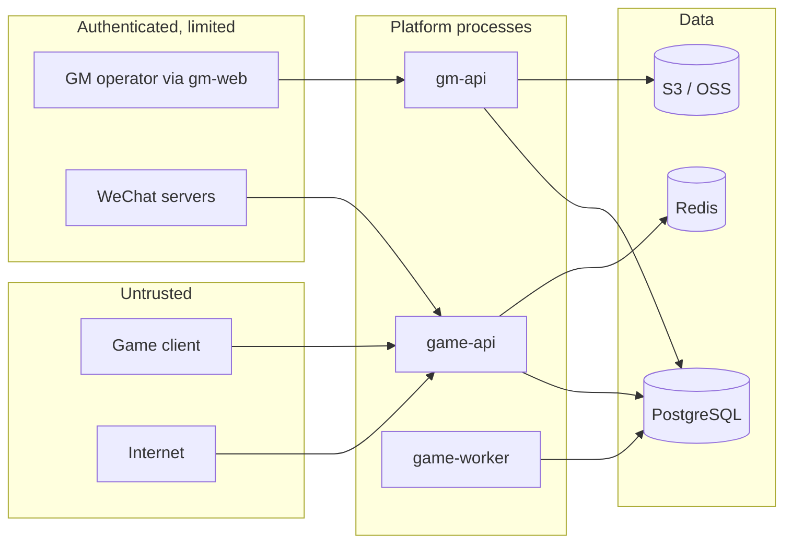

# Threat model

- **Status:** Draft for review (2026-11-23). This is a design-time model. No penetration test or security review has been performed, because no code exists yet.
- **Related:** [ADR-0002](../adr/ADR-0002-game-isolation.md), [ADR-0004](../adr/ADR-0004-data-authority-model.md), [ADR-0005](../adr/ADR-0005-api-service-boundaries.md), [ADR-0007](../adr/ADR-0007-economy-transaction-model.md)
- **Source:** sections 11 and 14 of the [technical design](../game-platform-technical-design.md)

Items marked **(proposal)** are not stated in the design document or an ADR and need confirmation.

## 1. What is worth protecting

| Asset | Why it matters |
|---|---|
| Currency balances, items, ledgers | Direct economic value; fraud distorts the game and, with ads, real revenue |
| Player identities (OpenID, UnionID), sessions | Personal data; account takeover |
| Player saves | Progress loss is the most visible failure for a player |
| Game configuration | A bad release breaks every client of a game at once |
| Administrator accounts and RBAC | One compromised operator can change assets for many players |
| Secrets: WeChat AppSecret, signing keys, MFA secrets, database credentials | Each one unlocks a whole plane |
| Audit logs | The only way to reconstruct what an operator did |
| Availability of login, save and settlement | The game is unplayable without them |

## 2. Who might attack

| Actor | Capability | Typical goal |
|---|---|---|
| Cheating player | Full control of their own client: can read and modify code, memory and every request | Free currency, items, ranks |
| Scripted abuser | Many accounts, automation, request replay | Farm ad and activity rewards |
| External attacker | Network access to public endpoints | Steal data, take over accounts, disrupt service |
| Malicious or careless operator | Valid GM credentials within some scope | Grant assets, leak data, publish a bad config |
| Compromised process | Code execution inside one container | Use that process's database role and secrets |
| Compromised dependency or pipeline | Code in the build | Any of the above |

## 3. Trust boundaries

Everything from the client is a claim. An operator is trusted only within permission and scope, and is audited. Each process is trusted only as far as its database role allows.

## 4. Threats and mitigations

"Verified by" names the task whose tests must demonstrate the mitigation. Until those tests exist, every mitigation below is a design intention.

### 4.1 Cheating and asset fraud

| ID | Threat | Mitigation | Residual risk | Verified by |
|---|---|---|---|---|
| T1 | Forged run result (score, win, reward) | Server-created run; server computes rewards from the recorded rule version; caps per run and per day; plausibility bounds; risk signals to `review` | A plausible forged result within caps is accepted. Client-run combat cannot be fully verified. | T10, T21 |
| T2 | Settling a run twice, or replaying a settlement | `UNIQUE (game_id, run_id)`; `Idempotency-Key`; run state check under lock | None expected | T10, T21 |
| T3 | Duplicate grant from any path (retry, job rerun, race) | Ledger unique key on business source; one transaction for balance and ledger | A wrong `source_id` design could let two events share or split a key | T11, T21 |
| T4 | Negative balance through concurrent spends | Row lock on the wallet; `CHECK (balance >= 0)` | None expected | T11 |
| T5 | Editing assets through the save | Assets live in their own tables; the server never reads assets from a save | Game code that derives value from save fields reintroduces the problem | T08 |
| T6 | Fake ad completion | Server session with expiry; single claim; daily limit; device and behaviour signals; low reward value | Without WeChat server-side verification, a scripted client can claim up to the daily limit. Adopting it is an open decision. | T12, T21 |
| T7 | Multi-account farming | Per-player limits; rate limits per IP and device; anomaly review | Limits are per account; many accounts multiply them | T12, T21 |
| T8 | Leaderboard manipulation | Scores come from accepted settlements; bounds per level; GM can rebuild and remove entries | Same limit as T1 | T14 |
| T9 | Claiming a mail or activity reward twice | `claimed_at` set once under lock; `UNIQUE (game_id, activity_id, player_id, reward_id)`; ledger unique key | None expected | T13, T21 |

### 4.2 Identity and sessions

| ID | Threat | Mitigation | Residual risk | Verified by |
|---|---|---|---|---|
| T10 | Stolen refresh token | Hash at rest; rotation on use; revocation; **(proposal)** reuse detection revokes the chain | A stolen token works until its first legitimate rotation | T07, T21 |
| T11 | Stolen access token | One-hour lifetime; TLS only; **(proposal)** session denylist | Valid until expiry if no denylist | T07 |
| T12 | Client chooses another game | Game resolved from `(platform, app_id)` on the server; `game_id` only from the token | None expected | T07, T21 |
| T13 | Reading or changing another player's data (IDOR) | No `player_id` parameters on `game-api`; ownership check in `gamecore`; composite keys | A new endpoint that takes an entity ID must check ownership | T21 |
| T14 | Leak of AppSecret or `session_key` | Secret store; `credential_ref` only in the database; never logged or returned | Depends on secret-store access control | T07, T20 |
| T15 | Login flooding or WeChat quota exhaustion | Rate limit per IP and app; timeouts and bounded retries to WeChat | A distributed flood needs edge protection | T07, T22 |
| T16 | Banned player keeps playing | Ban revokes sessions; login and refresh check the ban | Up to one access-token lifetime without the denylist | T08 |

### 4.3 Cross-game isolation

| ID | Threat | Mitigation | Residual risk | Verified by |
|---|---|---|---|---|
| T17 | A query without a game filter returns another game's rows | `game_id` required by every repository method; composite keys; optional RLS | Hand-written SQL that omits the filter, until RLS is on | T03, T21 |
| T18 | A row references a parent in another game | Composite foreign keys | None for constrained references; JSONB payloads are not constrained | T03 |
| T19 | Operator of game A acts on game B | Scope check on the path `game_id`; `403` without disclosure | A list endpoint that forgets to filter by scope | T15, T21 |
| T20 | Cache or storage key collision between games | Game ID in every key and path | — | T04 |

### 4.4 GM plane

| ID | Threat | Mitigation | Residual risk | Verified by |
|---|---|---|---|---|
| T21 | Operator account takeover | Password hashing; mandatory MFA; lockout; short access tokens; network restriction in front of `gm-api` | Phishing of a live session | T15, T21 |
| T22 | Operator grants assets to self or friends | `economy.grant` and `economy.deduct` held by few roles; mandatory reason; audit in the same transaction; adjustment metrics and alerts | V1 has no dual approval; one authorized operator can act alone | T11, T17 |
| T23 | Privilege escalation through role editing | `rbac.manage` at platform scope only; change is audited; cache TTL keeps revocation fast | A Super Admin is trusted by definition | T15 |
| T24 | Bad or malicious config release | JSON Schema validation; only validated versions publish; immutable releases; rollback; audit | Schema-valid but wrong values | T09 |
| T25 | Mass mail or batch reward by mistake | Second confirmation; reason; asynchronous job that can be cancelled; idempotent delivery | Already-delivered mail cannot be recalled automatically | T13, T18 |
| T26 | Tampering with audit logs | Append-only trigger; `INSERT`/`SELECT` only for `gm_api_runtime`; no access for other runtime roles; owner is `NOLOGIN` | Someone with owner or superuser access to the database | T03, T17 |
| T27 | Bulk export of player data by an operator | `player.read` per game; paginated lists; **(proposal)** no bulk export endpoint in V1 | Page-by-page scraping; reads are not audited in V1 | T15 |
| T28 | Browser attacks on `gm-web` (XSS, CSRF) | Bearer tokens instead of cookies for the API; output encoding by the framework; strict CORS allowlist; Content-Security-Policy **(proposal)** | Token storage in the browser is exposed to XSS | T16 |

### 4.5 Infrastructure and process

| ID | Threat | Mitigation | Residual risk | Verified by |
|---|---|---|---|---|
| T29 | Compromised `game-api` process | Its database role cannot read `admin` or `audit`, cannot alter ledgers, cannot run DDL | It can still write wallets through the ledger path; see option B in [database-roles-and-grants.md](../database/database-roles-and-grants.md) | T03 |
| T30 | SQL injection | Parameterized statements only; no SQL in handlers; least-privilege roles | — | T05, T21 |
| T31 | `internal-api` reachable from outside | Not deployed in V1; when deployed, private listener plus service authentication | Misconfigured ingress | T20 |
| T32 | Forged platform callback | Platform signature and timestamp check; deduplication; IP policy | Depends on correct use of each platform's scheme | When built |
| T33 | Secrets in the repository, images or logs | Secret store; redaction in the logger; secret scanning in CI **(proposal)** | — | T04, T20 |
| T34 | Vulnerable dependency or image | Dependency and image scanning in CI; pinned versions **(proposal)** | Zero-day | T20 |
| T35 | Data loss | Backups with point-in-time recovery; rehearsed restore; bucket versioning | Bounded by the RPO, which is not decided yet | T20, T22 |
| T36 | Denial of service | Edge rate limits and WAF; per-route limits; body size limits; timeouts | Volumetric attacks need provider-level protection | T22 |
| T37 | Worker runs a job twice or after losing its lease | Idempotent handlers; lease check before completing | A handler that is not idempotent | T18 |
| T38 | Personal data in logs or analytics | Log only IDs; no tokens, codes or session keys; event payload limits | Game code putting personal data into event payloads | T04 |

## 5. Risks accepted in V1

These are consequences of decisions already made. They are listed so that nobody assumes they are covered.

1. Client-run combat can be forged within the reward caps (T1).
2. Ad rewards can be farmed up to the daily limit unless server-side verification is adopted (T6).
3. A single authorized operator can adjust wallets without a second approver (T22).
4. Operator reads of player data are not audited (T27).
5. One PostgreSQL database is a shared failure domain for all games.

## 6. Open questions that change this model

- Adopt WeChat rewarded-ad server-side verification? (T6)
- Amount threshold and timing for dual approval. (T22)
- Session denylist for immediate revocation. (T11, T16)
- Enable RLS on the first candidate tables. (T17)
- `SECURITY DEFINER` write path for wallets. (T29)
- Retention periods for identifiers, events, ledgers and audit logs.
- RPO and RTO. (T35)

## 7. Keeping this current

The model is reviewed when an ADR changes, when an entry or a callback is added, when payments are introduced, and before each production release. T21 turns the "Verified by" column into tests; a mitigation without a passing test is not counted as in place.
