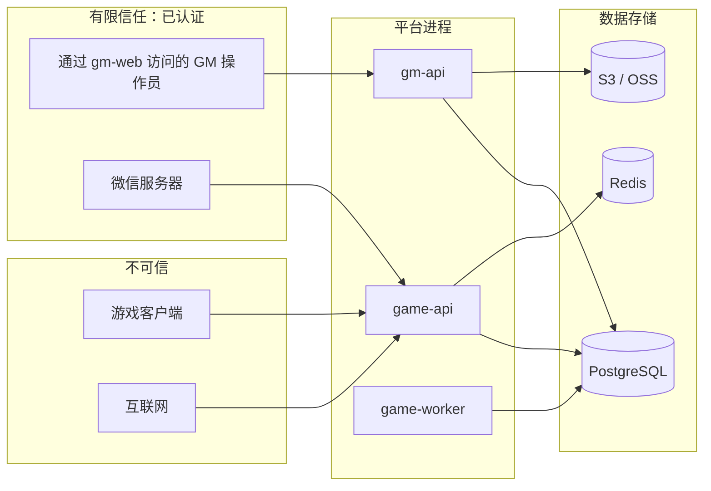

# 威胁模型

- **状态：** 评审草案（2026-11-23）。这是设计阶段的模型。由于尚无代码，未进行渗透测试或安全评审。
- **相关：** [ADR-0002](../adr/ADR-0002-game-isolation.md)、[ADR-0004](../adr/ADR-0004-data-authority-model.md)、[ADR-0005](../adr/ADR-0005-api-service-boundaries.md)、[ADR-0007](../adr/ADR-0007-economy-transaction-model.md)
- **来源：** [技术设计](../game-platform-technical-design.md)第 11 和 14 节

标记为**（提案）**的内容未在设计文档或 ADR 中说明，尚待确认。

## 1. 需要保护的资产

| 资产 | 重要性 |
|---|---|
| 货币余额、道具和流水 | 直接经济价值；欺诈会破坏游戏平衡，结合广告还会影响真实收入 |
| 玩家身份（OpenID、UnionID）和会话 | 个人数据；可能导致账号被盗 |
| 玩家存档 | 进度丢失是玩家最容易察觉的问题 |
| 游戏配置 | 错误发布会同时影响该游戏的所有客户端 |
| 管理员账号与 RBAC | 一个被攻破的运营账号可能修改许多玩家的资产 |
| 密钥：微信 AppSecret、签名密钥、MFA 密钥、数据库凭据 | 每个密钥都可能打开一个安全平面 |
| 审计日志 | 重建运营人员操作经过的唯一依据 |
| 登录、存档和结算服务可用性 | 服务不可用时游戏无法正常运行 |

## 2. 潜在攻击者

| 攻击者 | 能力 | 常见目标 |
|---|---|---|
| 作弊玩家 | 完全控制自己的客户端，可读取和修改代码、内存及所有请求 | 获取免费货币、道具或排行榜名次 |
| 脚本滥用者 | 多账号、自动化、重放请求 | 批量获取广告和活动奖励 |
| 外部攻击者 | 访问公网端点 | 窃取数据、盗号、干扰服务 |
| 恶意或疏忽的运营人员 | 在某个授权范围内持有有效 GM 凭据 | 发放资产、泄露数据、发布错误配置 |
| 被攻破的进程 | 在某个容器内执行代码 | 滥用该进程的数据库角色和密钥 |
| 被攻破的依赖或流水线 | 将代码注入构建过程 | 实现上述任一目标 |

## 3. 信任边界

客户端发送的内容都只是声明。运营人员仅在其权限和范围内受信任，且操作会被审计。每个进程的可信程度不得超过其数据库角色所允许的范围。

## 4. 威胁与缓解措施

“验证任务”列出必须通过测试证明缓解措施有效的任务。在这些测试完成前，以下措施都只是设计意图。

### 4.1 作弊与资产欺诈

| ID | 威胁 | 缓解措施 | 剩余风险 | 验证任务 |
|---|---|---|---|---|
| T1 | 伪造对局结果（分数、胜负、奖励） | 服务端创建对局；依据记录的规则版本计算奖励；设置单局和每日上限；范围合理性校验；将风险信号标记为 `review` | 限额内看似合理的伪造结果仍可能被接受；无法完全验证客户端战斗 | T10、T21 |
| T2 | 重复结算或重放结算 | `UNIQUE (game_id, run_id)`、`Idempotency-Key`、加锁后检查对局状态 | 预期无 | T10、T21 |
| T3 | 通过重试、任务重跑或并发导致重复发放 | 业务来源流水唯一键；余额和流水在同一事务写入 | 错误的 `source_id` 设计可能使不同事件共享或拆分唯一键 | T11、T21 |
| T4 | 并发扣款导致余额为负 | 锁定钱包行；`CHECK (balance >= 0)` | 预期无 | T11 |
| T5 | 通过存档篡改资产 | 资产存于独立表；服务端绝不从存档读取资产 | 游戏代码若根据存档字段派生价值，会重新引入风险 | T08 |
| T6 | 伪造广告完成 | 服务端广告会话和过期时间；单次领取；每日限额；设备与行为信号；奖励价值较低 | 未采用微信服务端验证时，脚本客户端仍可领取每日限额内奖励；是否采用仍待决定 | T12、T21 |
| T7 | 多账号刷取奖励 | 按玩家限额；按 IP 和设备限流；异常行为评审 | 限额按账号计算，多账号会放大收益 | T12、T21 |
| T8 | 篡改排行榜 | 分数取自已接受的结算；按关卡设限；GM 可重建并移除条目 | 与 T1 相同 | T14 |
| T9 | 重复领取邮件或活动奖励 | 在锁内只设置一次 `claimed_at`；`UNIQUE (game_id, activity_id, player_id, reward_id)`；流水唯一键 | 预期无 | T13、T21 |

### 4.2 身份与会话

| ID | 威胁 | 缓解措施 | 剩余风险 | 验证任务 |
|---|---|---|---|---|
| T10 | Refresh token 被盗 | 静态哈希存储；使用时轮换；支持撤销；**（提案）** 检测重用并撤销整条会话链 | 在首次合法轮换前，被盗令牌仍可使用 | T07、T21 |
| T11 | Access token 被盗 | 有效期一小时；仅使用 TLS；**（提案）** 会话拒绝名单 | 未设置拒绝名单时，令牌在过期前仍有效 | T07 |
| T12 | 客户端选择其他游戏 | 服务端根据 `(platform, app_id)` 解析游戏；`game_id` 只从令牌获取 | 预期无 | T07、T21 |
| T13 | 通过 IDOR 读取或修改其他玩家数据 | `game-api` 不接受 `player_id` 参数；`gamecore` 检查所有权；使用复合键 | 新端点若接受实体 ID，必须检查所有权 | T21 |
| T14 | AppSecret 或 `session_key` 泄露 | 使用密钥库；数据库只存 `credential_ref`；不写日志、不返回 | 取决于密钥库访问控制 | T07、T20 |
| T15 | 登录洪泛或耗尽微信配额 | 按 IP 和应用限流；对微信请求设置超时和有界重试 | 分布式洪泛需边缘防护 | T07、T22 |
| T16 | 被封禁玩家继续游戏 | 封禁时撤销会话；登录和刷新时检查封禁 | 未启用拒绝名单时，最长仍可使用一个 access token 有效期 | T08 |

### 4.3 跨游戏隔离

| ID | 威胁 | 缓解措施 | 剩余风险 | 验证任务 |
|---|---|---|---|---|
| T17 | 查询漏掉游戏过滤条件，返回其他游戏的数据 | 每个 Repository 方法都要求 `game_id`；复合键；可选 RLS | 尚未启用 RLS 时，手写 SQL 仍可能遗漏过滤条件 | T03、T21 |
| T18 | 记录引用其他游戏的父项 | 复合外键 | JSONB 负载不受外键约束；其他受约束引用无剩余风险 | T03 |
| T19 | 游戏 A 的运营人员操作游戏 B | 校验路径中的 `game_id` 范围；拒绝时不披露信息并返回 `403` | 列表端点可能忘记按范围过滤 | T15、T21 |
| T20 | 不同游戏间缓存键或存储路径冲突 | 每个键和路径都包含游戏 ID | — | T04 |

### 4.4 GM 安全平面

| ID | 威胁 | 缓解措施 | 剩余风险 | 验证任务 |
|---|---|---|---|---|
| T21 | 运营账号被接管 | 密码哈希；强制 MFA；失败锁定；短时 access token；限制 `gm-api` 的网络访问 | 有效会话可能遭钓鱼窃取 | T15、T21 |
| T22 | 运营人员向自己或熟人发放资产 | 仅少数角色持有 `economy.grant` 和 `economy.deduct`；必须填写原因；同事务审计；调账指标和告警 | V1 无双人审批；一名获授权人员可独自操作 | T11、T17 |
| T23 | 通过编辑角色提升权限 | `rbac.manage` 仅限平台范围；变更会审计；缓存 TTL 确保撤权快速生效 | 超级管理员本身属于受信任主体 | T15 |
| T24 | 错误或恶意配置发布 | JSON Schema 校验；仅发布已校验版本；发布不可变；支持回滚；记录审计 | 符合 Schema 的值仍可能不正确 | T09 |
| T25 | 误发群发邮件或批量奖励 | 二次确认；必填原因；可取消的异步任务；幂等投递 | 已投递邮件无法自动撤回 | T13、T18 |
| T26 | 篡改审计日志 | 只追加触发器；`gm_api_runtime` 仅有 `INSERT`/`SELECT`；其他运行时角色无权限；所有者为 `NOLOGIN` | 拥有数据库所有者或超级用户权限者仍可篡改 | T03、T17 |
| T27 | 运营人员批量导出玩家数据 | 按游戏授予 `player.read`；列表分页；**（提案）** V1 不提供批量导出端点 | 可逐页抓取；V1 不审计读取行为 | T15 |
| T28 | 针对 `gm-web` 的浏览器攻击（XSS、CSRF） | API 使用 Bearer token 而非 Cookie；框架负责输出编码；严格 CORS 允许列表；**（提案）** Content-Security-Policy | XSS 仍可能窃取浏览器中的令牌 | T16 |

### 4.5 基础设施与进程

| ID | 威胁 | 缓解措施 | 剩余风险 | 验证任务 |
|---|---|---|---|---|
| T29 | `game-api` 进程被攻破 | 数据库角色不能读取 `admin` 或 `audit`、不能修改流水、不能执行 DDL | 仍可通过流水路径写钱包；详见[数据库角色与授权](../database/database-roles-and-grants.md)中的选项 B | T03 |
| T30 | SQL 注入 | 仅使用参数化语句；Handler 中无 SQL；角色权限最小化 | — | T05、T21 |
| T31 | `internal-api` 可从外部访问 | V1 不部署；部署时使用私有监听并要求服务认证 | 入口配置错误 | T20 |
| T32 | 伪造平台回调 | 平台签名和时间戳校验；去重；IP 策略 | 依赖对各平台方案的正确实现 | 实现时验证 |
| T33 | 密钥进入仓库、镜像或日志 | 密钥管理器；日志脱敏；**（提案）** 在 CI 中扫描密钥 | — | T04、T20 |
| T34 | 依赖或镜像存在漏洞 | **（提案）** 在 CI 中扫描依赖和镜像，并固定版本 | 零日漏洞 | T20 |
| T35 | 数据丢失 | 支持时间点恢复的备份；演练恢复；存储桶版本控制 | 恢复能力受尚未确定的 RPO 限制 | T20、T22 |
| T36 | 拒绝服务 | 边缘限流和 WAF；按路由限流；请求体大小限制；超时 | 流量型攻击需要服务提供方层面的防护 | T22 |
| T37 | Worker 重复执行任务或租约丢失后继续执行 | 处理器幂等；完成前检查租约 | 未幂等的处理器仍会造成风险 | T18 |
| T38 | 日志或分析数据中包含个人信息 | 只记录 ID；不记录令牌、code 或会话密钥；限制事件负载 | 游戏代码可能把个人信息写入事件负载 | T04 |

## 5. V1 接受的风险

这些风险是既定决策的后果，列出以免误以为已有防护：

1. 客户端战斗结果可在奖励上限内伪造（T1）。
2. 未启用服务端验证时，广告奖励可被刷到每日上限（T6）。
3. 一名获授权运营人员可以在没有第二人批准时调账（T22）。
4. 不审计运营人员对玩家数据的读取（T27）。
5. 所有游戏共用一套 PostgreSQL，形成共同故障域。

## 6. 会改变本模型的待决问题

- 是否采用微信激励广告服务端验证？（T6）
- 双人审批的金额门槛和实施时间。（T22）
- 是否设置即时撤销用的会话拒绝名单。（T11、T16）
- 是否为首批候选表启用 RLS。（T17）
- 钱包是否使用 `SECURITY DEFINER` 写入路径。（T29）
- 玩家标识、事件、流水和审计日志的保留期限。
- RPO 和 RTO。（T35）

## 7. 模型维护

ADR 变更、新增入口或回调、引入支付以及每次生产发布前，都要重新评审本模型。T21 会把“验证任务”列落实为测试；未通过测试验证的缓解措施不得视为已启用。
